<div align="center">

# ⚡ FPGA-Based CNN Accelerator

### Handwritten Digit Recognition | Verilog RTL | Zynq-7000 | ASIC Design Exploration

<p>
  
  
  
  
</p>

**A hardware implementation of CNN inference, from RTL simulation to FPGA deployment, with an accompanying standard-cell synthesis and physical-design exploration.**

[Architecture](#-system-architecture) ·
[FPGA Results](#-fpga-implementation) ·
[ASIC Flow](#-asic-synthesis--physical-design) ·
[Setup](#-getting-started) ·
[Gallery](#-project-gallery)

<br>

<table>
  <tr>
    <td align="center"><strong>28 × 28</strong><br><sub>Input image</sub></td>
    <td align="center"><strong>784</strong><br><sub>Pixel values</sub></td>
    <td align="center"><strong>10</strong><br><sub>Output classes</sub></td>
    <td align="center"><strong>100 MHz</strong><br><sub>Clock constraint</sub></td>
  </tr>
</table>

</div>

> [!IMPORTANT]
> **Current status:** RTL simulation and Vivado bitstream generation are complete. The Zynq-7000 device was programmed and inspected through Hardware Manager using ILA/VIO. Genus synthesis reports and Innovus floorplan/verification snapshots are also documented. The available Innovus log still shows unassigned I/O warnings; this README does not claim completed ASIC sign-off.

<div align="center">
  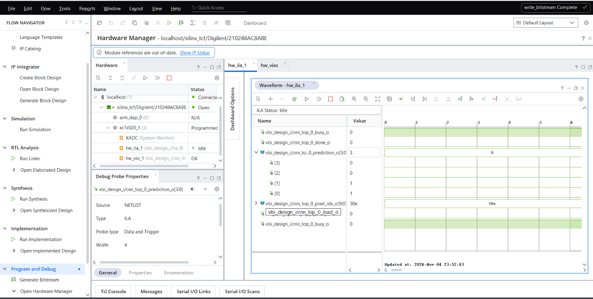
  <br>
  <sub><em>FPGA bring-up: programmed device, Hardware Manager and internal-signal visibility.</em></sub>
</div>


## 🧭 Explore the Project

| | | |
|:---:|:---:|:---:|
| [Overview](#-project-overview) | [Architecture](#-system-architecture) | [Inference](#-cnn-inference-pipeline) |
| [FPGA](#-fpga-implementation) | [ILA / VIO](#-fpga-platform--on-chip-debug) | [Genus / Innovus](#-asic-synthesis--physical-design) |
| [Results](#-results--evidence) | [Reproduce](#-getting-started-vivado) | [Future Work](#-future-improvements) |

<details>
<summary><strong>Full table of contents</strong></summary>

- [Project Overview](#-project-overview)
- [Project Objectives](#-project-objectives)
- [System Architecture](#-system-architecture)
- [CNN Inference Pipeline](#-cnn-inference-pipeline)
- [FPGA Implementation](#-fpga-implementation)
- [FPGA Platform & On-Chip Debug](#-fpga-platform--on-chip-debug)
- [ASIC Synthesis & Physical Design](#-asic-synthesis--physical-design)
- [Results & Evidence](#-results--evidence)
- [Repository Structure](#-repository-structure)
- [Getting Started: Vivado](#-getting-started-vivado)
- [Getting Started: Cadence](#-getting-started-cadence)
- [Engineering Notes](#-engineering-notes)
- [Future Improvements](#-future-improvements)
- [Acknowledgements](#-acknowledgements)

</details>


## ✨ Project Overview

Convolutional Neural Networks are widely used for image classification, but running neural-network inference on a general-purpose processor can introduce latency and energy overhead. This project explores a dedicated digital hardware implementation of CNN inference.

The accelerator is designed to process a **28 × 28 grayscale handwritten-digit image** (784 pixel values) and produce a digit-class prediction in the range **0–9**. The RTL design contains the datapath and control logic needed to perform the CNN computation, while the FPGA implementation makes it possible to test the design on real programmable logic.

The project also explores the ASIC implementation flow. RTL is synthesized with Cadence Genus, and the resulting design is taken into the Innovus physical-design environment for floorplanning and implementation checks.

### Project at a glance

| Item | Details |
|---|---|
| Project | FPGA-Based CNN Accelerator |
| Application | Handwritten-digit classification |
| Input image | 28 × 28 grayscale image |
| Input pixels | 784 |
| Output classes | 10 (digits 0–9) |
| Hardware description | Verilog HDL |
| FPGA toolchain | AMD/Xilinx Vivado |
| FPGA device shown in reports | Zynq-7000 `xc7z020clg484-1` |
| Board/debug environment | Digilent ZedBoard / Vivado Hardware Manager |
| On-chip debug | Integrated Logic Analyzer (ILA) and Virtual I/O (VIO) |
| ASIC synthesis | Cadence Genus 21.1 |
| Physical-design exploration | Cadence Innovus 21.15 |
| Standard-cell library shown | `fast_vdd1v0` |
| Main verification focus | RTL simulation, FPGA programming, internal-signal inspection |

---

## 🎯 Project Objectives

1. Translate a CNN inference datapath into synthesizable RTL.
2. Implement the required convolution, pooling, fully connected and classification operations in hardware.
3. Use a controlled input interface to load image data and initiate inference.
4. Generate a bitstream and program the Zynq-7000 programmable logic.
5. Inspect internal control and data signals with ILA/VIO rather than relying only on external output pins.
6. Synthesize the RTL with Cadence Genus and inspect area, cell-count, timing and power reports.
7. Explore floorplanning and physical-design verification in Cadence Innovus.
8. Document the design flow and measured tool outputs so that the work can be reproduced and extended.

---

### End-to-end design journey

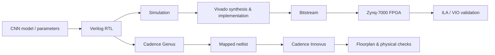

## 🧠 System Architecture

<sub>[↑ Back to top](#-fpga-based-cnn-accelerator)</sub>


At a high level, the accelerator follows this dataflow:

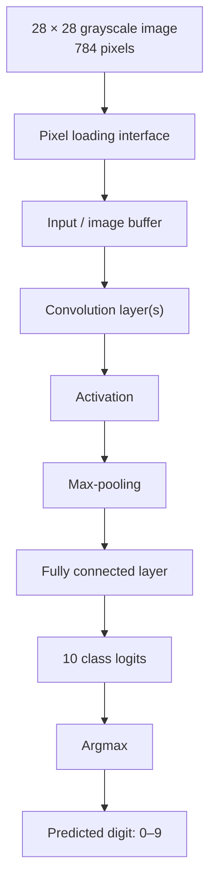

The RTL source is organized into functional modules. The exact layer dimensions, fixed-point formats, parameter files and module interfaces should be taken from the corresponding source files in the repository; they are intentionally not guessed in this README.

### RTL module map

| Block | Responsibility |
|---|---|
| `cnn_top` | Top-level integration, input/control interface and prediction output |
| `conv_layer` | Convolution computation using the configured weights and biases |
| `maxpool` | Spatial down-sampling by selecting local maximum values |
| `fully_connected` | Dense-layer multiply-accumulate computation |
| `argmax` | Selects the class index with the highest output score |
| Testbench | Drives input images and checks/observes simulation outputs |

The module names above reflect the project RTL organization discussed during development. Check the actual source tree for the definitive filenames and port declarations.

---

## 🔄 CNN Inference Pipeline

### 4.1 Input loading

The input image contains 784 grayscale pixels. The debug interface includes a pixel index signal (`pixel_idx`) and a load control signal (`load`), allowing the input-loading sequence to be inspected.

### 4.2 Convolution

Convolution layers apply learned kernels to local image regions. Each output feature value is formed from weighted input samples and an accumulated bias. In hardware, these operations are implemented using arithmetic datapaths and control sequencing.

### 4.3 Activation and pooling

The activation stage introduces non-linearity. Max-pooling reduces the spatial dimensions of feature maps by retaining the maximum value in each pooling region. This reduces the amount of data passed to later stages.

### 4.4 Fully connected classification

The final feature representation is processed by the fully connected stage to produce class scores (logits). The simulation waveform includes ten 32-bit logit signals (`logit0` through `logit9`).

### 4.5 Argmax

The argmax block selects the index of the largest logit. The prediction bus is four bits wide, which is sufficient to represent the ten digit classes.

---

## 🧩 FPGA Implementation

<sub>[↑ Back to top](#-fpga-based-cnn-accelerator)</sub>


The design was developed and implemented using Verilog RTL and Vivado.

The implementation flow is:

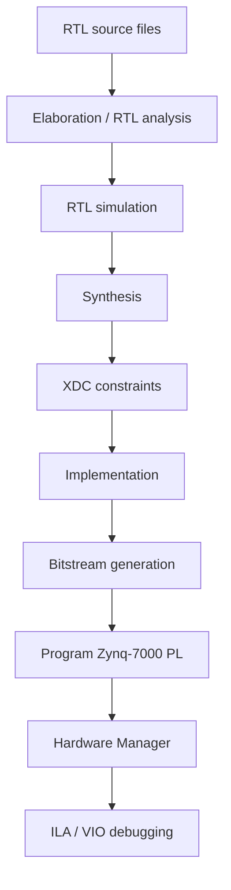

The project screenshots show a completed Vivado bitstream-generation operation and a programmed `xc7z020_1` device in Hardware Manager.

### Target platform

- **Device:** `xc7z020clg484-1` (Zynq-7000)
- **Clock constraint used during development:** 100 MHz (`10 ns` period)
- **Clock constraint example:**

```tcl
set_property -dict { PACKAGE_PIN Y9 IOSTANDARD LVCMOS33 } [get_ports {clk}]
create_clock -name sys_clk -period 10.000 -waveform {0.000 5.000} [get_ports {clk}]
```

Use the board's official master XDC and verify every package pin against the exact ZedBoard revision before using physical I/O. The snippet above is an example from the project work, not a substitute for a complete board constraint file.

---

## 🧪 FPGA Platform & On-Chip Debug

### 6.1 Signals monitored by ILA

The Hardware Manager captures show these internal signals:

| Signal | Meaning |
|---|---|
| `busy_o` | Indicates that the accelerator is occupied with an operation |
| `done_o` | Indicates completion of an inference operation |
| `prediction_o[3:0]` | Four-bit predicted digit |
| `pixel_idx_o[9:0]` | Index associated with the input pixel stream |
| `load_o` | Input-loading control/status signal |

The ILA is especially useful because it exposes internal signals without requiring every datapath signal to be routed to an external FPGA pin. This keeps the top-level I/O interface manageable and avoids unnecessarily high I/O-bank utilization.

### 6.2 Simulation evidence

The simulation waveform screenshot shows the prediction output alongside ten 32-bit logits, the image array, loop/index signals and the ground-truth label. In the captured example, `GT_LABEL` is `9` and `prediction` is `9`.

This is a useful example-level functional check. It is not, by itself, a complete accuracy evaluation across a test dataset.

### 6.3 On-board debug captures

The ILA screenshots document several observed prediction-bus values while the pixel index is shown near the end of the 784-pixel input sequence (`0x30E`, decimal 782). The captures are included as debug evidence. Since the screenshots are individual snapshots, they should not be treated as a complete test-vector table or as proof that each displayed prediction corresponds to a known ground-truth label.

## 🖼️ Complete Project Image Gallery

**All 25 original project screenshots are displayed below, in sequence.**
Nothing is hidden inside collapsed panels. Scroll through the complete Vivado, Genus and Innovus evidence.

#### Vivado ILA and Hardware Manager screenshots


**Hardware Manager / programmed device**

**01 · Vivado Hardware Manager — programmed Zynq-7000 device**


---

**ILA capture sequence**

**02 · ILA capture 02**

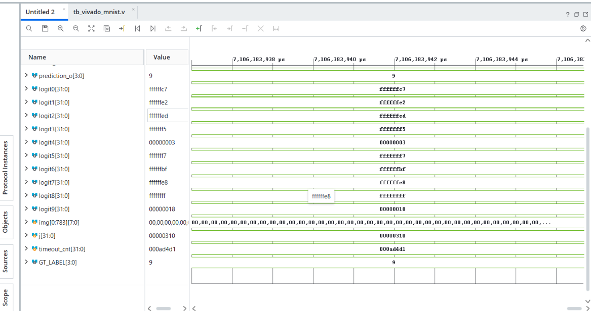

---

**03 · ILA capture 03**

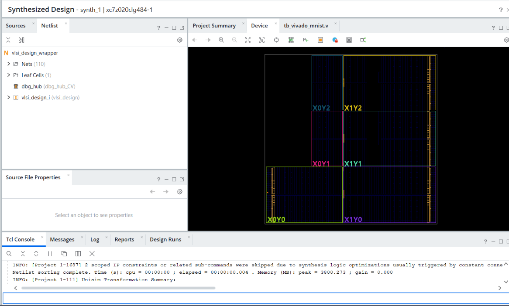

---

**04 · ILA capture 04**

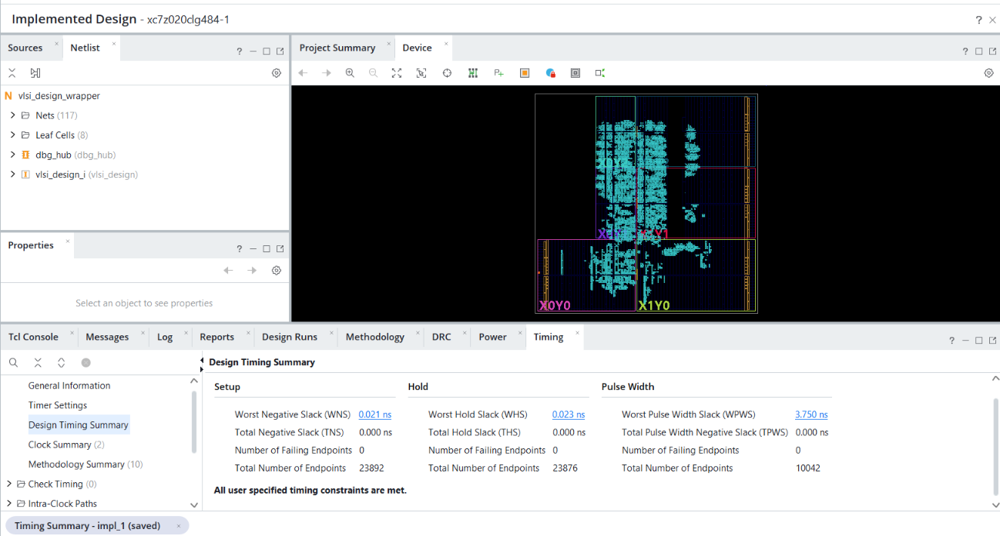

---

**05 · ILA capture 05**

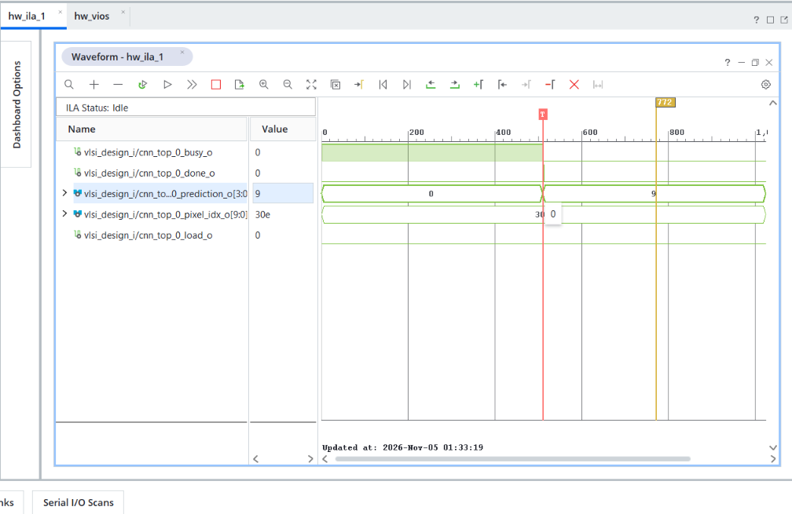

---

**06 · ILA capture 06**

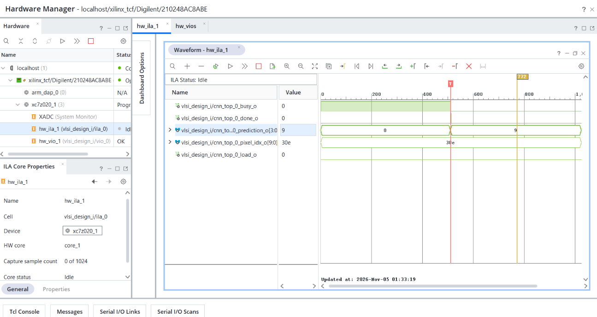

---

**07 · ILA capture 07**

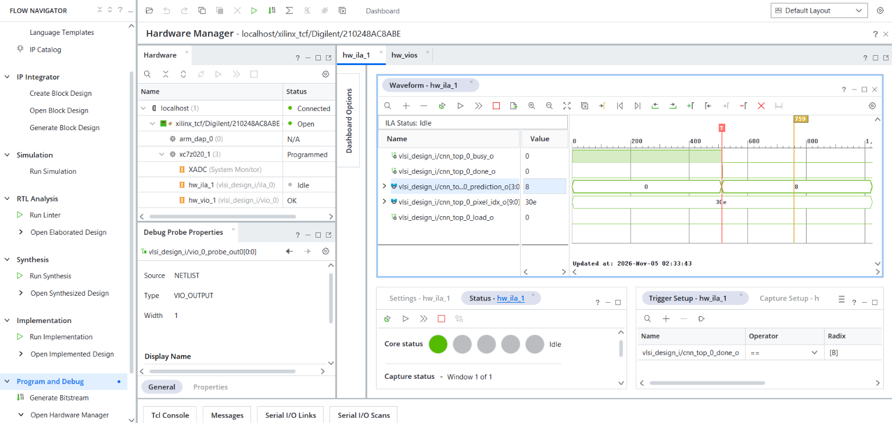

---

**08 · ILA capture 08**

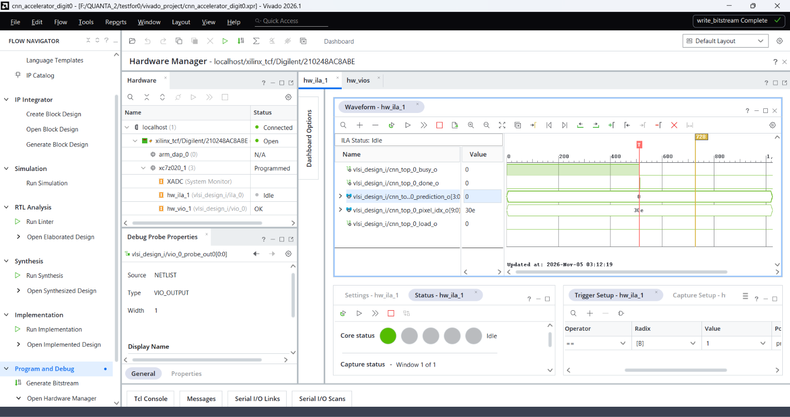

---

**09 · ILA capture 09**

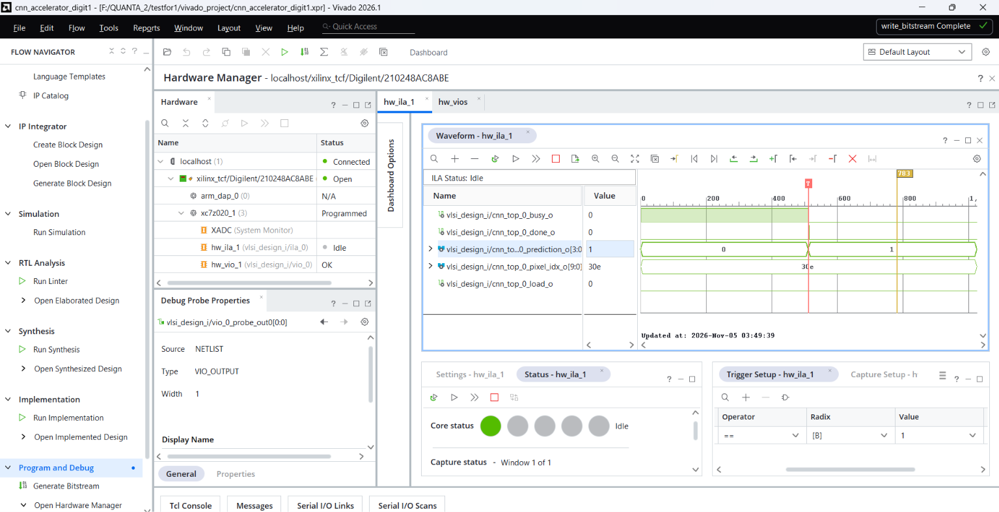

---

**10 · ILA capture 10**

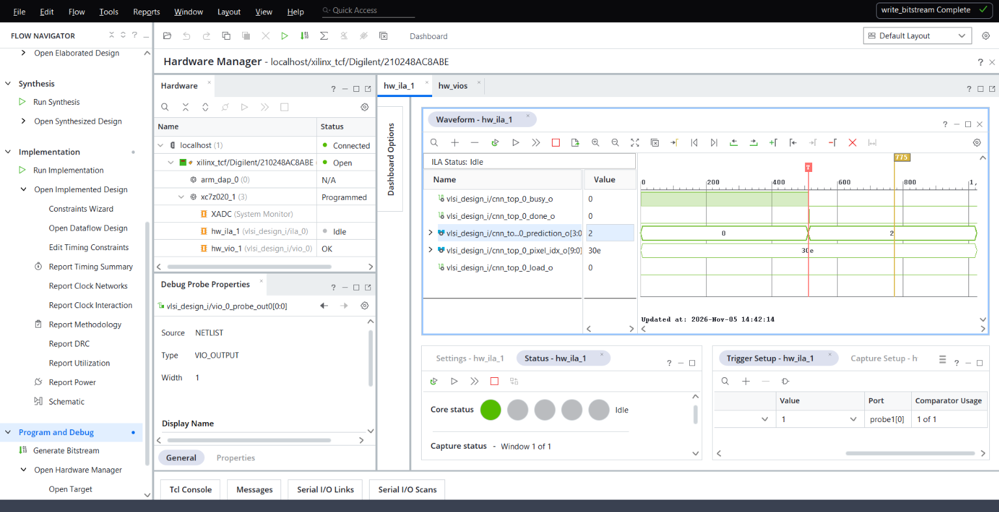

---

**11 · ILA capture 11**

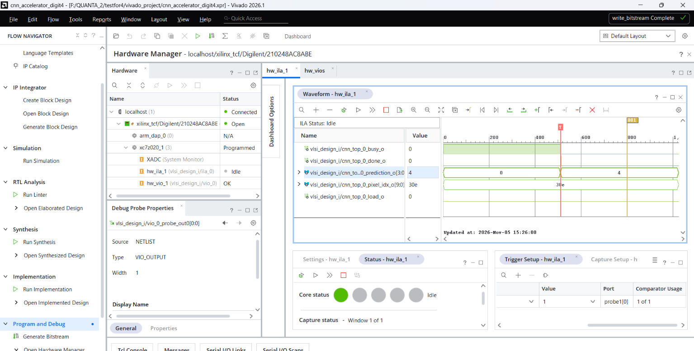

---

**12 · ILA capture 12**


---

**13 · ILA capture 13**

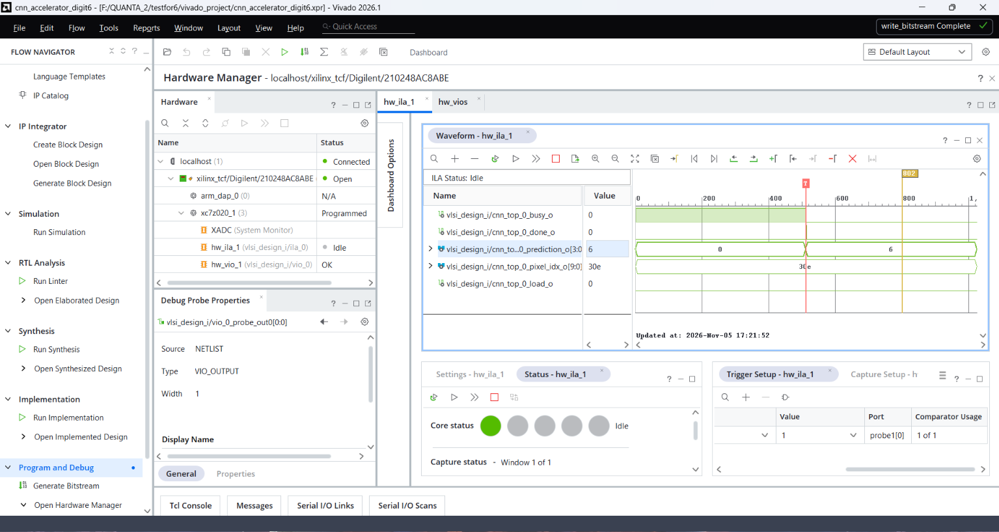

---

**14 · ILA capture 14**

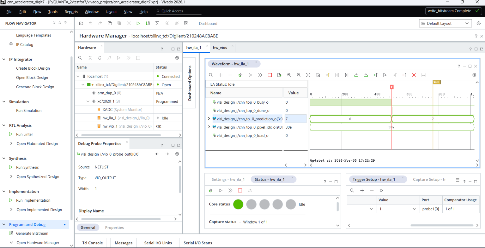

---

**Additional ILA capture — prediction bus = 3**

**15 · ILA capture — prediction bus = 3**


---

## 🏭 ASIC Synthesis & Physical Design

<sub>[↑ Back to top](#-fpga-based-cnn-accelerator)</sub>


In addition to FPGA implementation, the RTL was taken through a standard-cell synthesis and physical-design exploration flow using Cadence tools.

### 7.1 Genus — logic synthesis

Cadence Genus was used to elaborate and synthesize the CNN top-level design against the configured standard-cell library. The captured reports provide a snapshot of the synthesized design.

**Reported synthesis snapshot**

| Metric | Value shown in report |
|---|---:|
| Top module | `cnn_top` |
| Standard-cell instances | 573 |
| Total cell area | 1335.168 |
| Technology library | `fast_vdd1v0` 1.0 |
| Operating condition shown | `PVT_1P1V_0C` |
| Leakage power | 77.331 nW |
| Internal power | 199003.523 nW |
| Net power | 38773.215 nW |
| Switching power | 237776.738 nW |

The report labels the area as 1335.168 library area units. Do not interpret this as µm² unless the library's area units and technology setup confirm that conversion.

The power values are tool-estimated values under the report's configured operating conditions and activity assumptions. They are not board-level power measurements. The four displayed components sum to approximately **475.631 µW**.

The mapped-gates and gate-count reports show the cell composition and a total of 573 instances.

#### Genus screenshots


**Synthesized design view**

**16 · Genus synthesized design view**

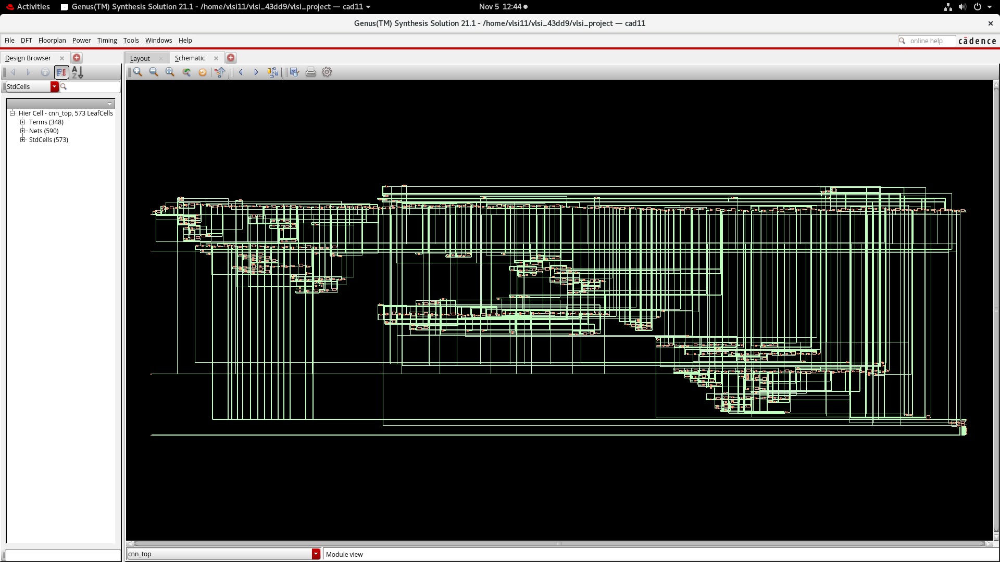

---

**Power details report**

**17 · Genus power report**

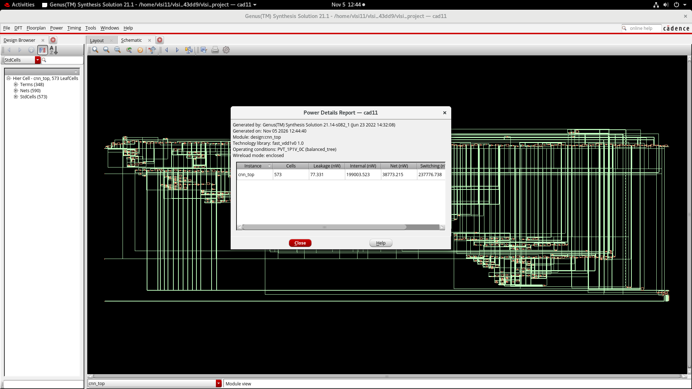

---

**Mapped gates report**

**18 · Genus mapped-gates report**

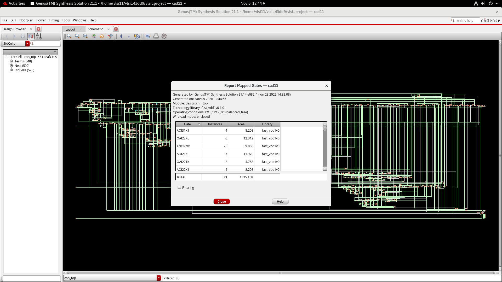

---

**Gate count report**

**19 · Genus gate-count report**

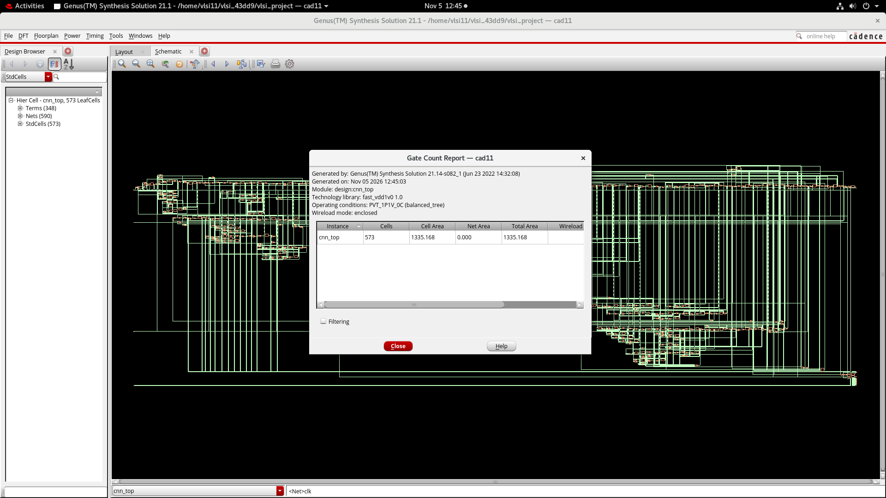

---

**Timing debug report**

**20 · Genus timing-debug report**

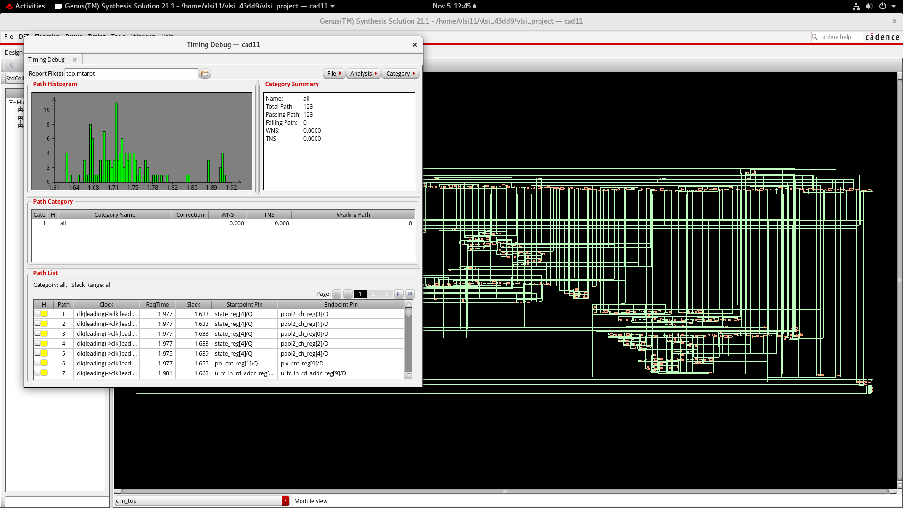

### 7.2 Timing report

The captured Genus Timing Debug window reports:

- Total paths: **123**
- Passing paths: **123**
- Failing paths: **0**
- WNS: **0.0000**
- TNS: **0.0000**

The path list shows positive slack values in the displayed entries. These results describe the report and constraints used for that run. For a formal timing claim, retain the SDC, library setup, complete timing reports and exact run configuration.

### 7.3 Innovus — physical-design exploration

The synthesized design was opened in Cadence Innovus for physical-design work. The supplied screenshots document floorplan/layout views, I/O pin visibility and verification output.

The physical-design flow generally proceeds through:

```text
Genus synthesized netlist
          |
          v
      Innovus setup
          |
          v
      Floorplanning
          |
          v
    Power planning
          |
          v
       Placement
          |
          v
    Clock-tree synthesis
          |
          v
       Routing
          |
          v
    DRC / connectivity
          |
          v
     Timing analysis
```

The screenshots show the design in the Innovus layout environment and a verification log. They do not establish that every stage in this flow has completed.

**Connectivity and DRC observation:** the captured log reports `Verification Complete: 0 DRC violations`. The same log also displays warnings that several top-level I/O pins (including clock, reset, start, pixel and load signals) have not been assigned to physical pins. Therefore, the zero-violation DRC result must not be confused with a fully constrained or board-ready I/O implementation. Assign the required I/O pins and rerun connectivity verification before treating the interface as complete.

#### Innovus screenshots


**Initial floorplan/layout view**

**21 · Innovus initial floorplan**


---

**Floorplan/layout view**

**22 · Innovus floorplan view**

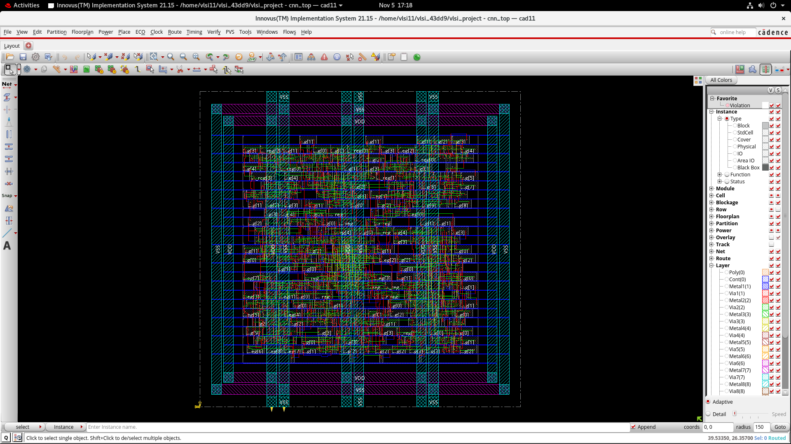

---

**Updated floorplan/layout view**

**23 · Innovus updated floorplan**

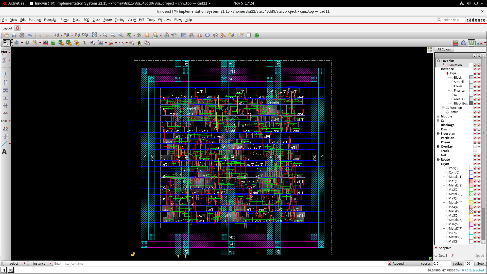

---

**Connectivity and DRC verification log**

**24 · Innovus connectivity and DRC log**

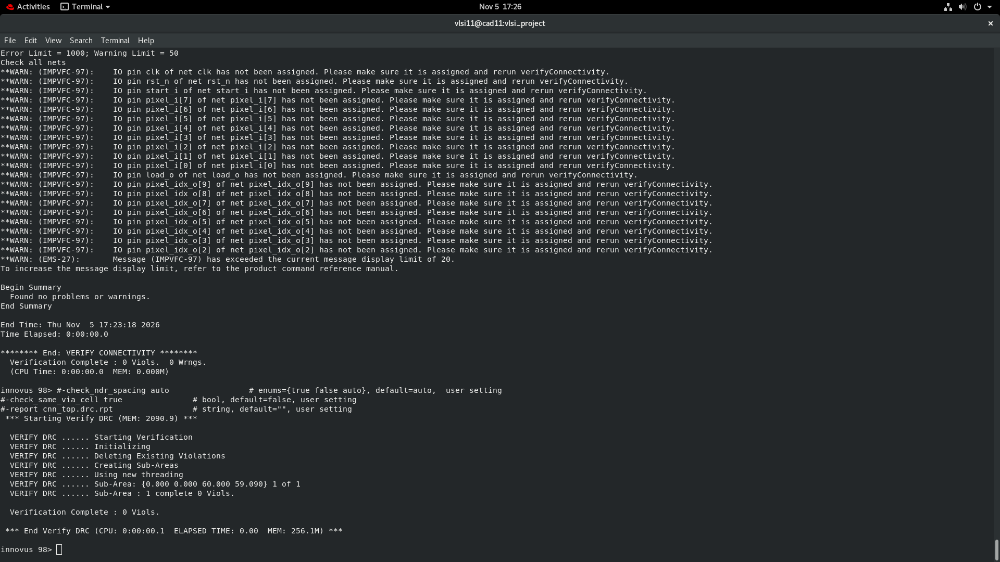

---

**Later Innovus layout view**

**25 · Innovus layout view**

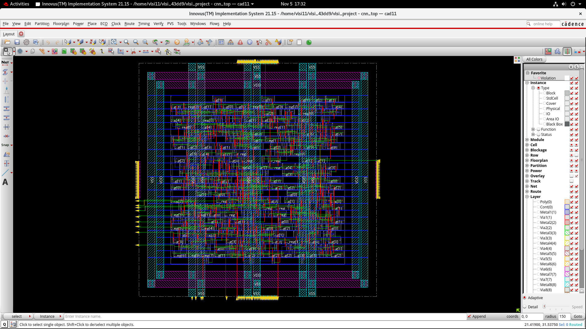

---

### FPGA and ASIC tool flows at a glance

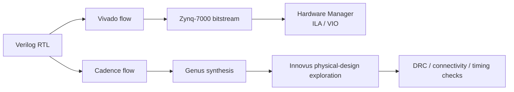

## 📊 Results & Evidence

<sub>[↑ Back to top](#-fpga-based-cnn-accelerator)</sub>


| Stage | Evidence / observation | Interpretation |
|---|---|---|
| RTL simulation | Example waveform shows `GT_LABEL = 9` and `prediction = 9` | Example-level functional agreement |
| Vivado synthesis | Synthesized design opened for inspection | RTL was synthesized for the selected FPGA device |
| Vivado implementation | Implemented design and timing summary screenshots | Implementation completed in the shown run; inspect the saved reports for exact resource/timing values |
| Bitstream | Vivado reports `write_bitstream Complete` | Bitstream generation completed |
| FPGA programming | Hardware Manager shows the Zynq-7000 device as programmed | Bitstream was loaded onto the target PL |
| ILA/VIO | Internal control, pixel-index and prediction signals visible | On-device internal debug was established |
| Genus synthesis | 573 cells; area 1335.168 | Synthesis report snapshot |
| Genus timing | 123 passing paths, 0 failing paths in the displayed report | No failing paths in that captured timing report |
| Genus power | Component power values shown in the report | Estimated power under the configured library/conditions |
| Innovus verification | 0 DRC violations in the captured run | No DRC violations reported in that run; I/O assignment warnings remain |

> [!NOTE]
> The reported Genus figures are synthesis-tool estimates under the displayed library and operating conditions. They are not FPGA resource counts or measured board power.

### Important distinction

The FPGA and ASIC flows have different targets and constraints:

- **Vivado:** implementation for the Zynq-7000 FPGA device.
- **Genus/Innovus:** standard-cell synthesis and physical-design exploration using a separate technology library.

Area and power numbers from Genus must not be directly compared with FPGA LUT/FF/BRAM/DSP utilization or board power without a carefully defined methodology.

---

## 📁 Repository Structure

<sub>[↑ Back to top](#-fpga-based-cnn-accelerator)</sub>


The following is a suggested organization. Keep the actual filenames already used by your project if they differ.

```text
FPGA-Based-CNN-Accelerator/
├── README.md
├── README_assets/
│   ├── vivado/
│   ├── genus/
│   └── innovus/
├── rtl/
│   ├── cnn_top.v
│   ├── conv_layer.v
│   ├── maxpool.v
│   ├── fully_connected.v
│   └── argmax.v
├── tb/
│   └── tb_vivado_mnist.v
├── constraints/
│   └── zedboard.xdc
├── params/
│   ├── weights/
│   └── biases/
├── sim/
├── vivado/
└── cadence/
    ├── genus/
    └── innovus/
```

The `README_assets` directory in this documentation bundle contains the screenshots embedded above. The other directories are a suggested layout, not a claim that every folder is present in the current repository.

---

## 🚀 Getting Started: Vivado

1. Clone or download the repository.
2. Open the Vivado project (`.xpr`) or create a project for the correct Zynq-7000 part.
3. Add all RTL source files and set the intended top module.
4. Add the testbench files as simulation sources.
5. Ensure all initialization files (`.mem`, weights and biases) are available at the paths expected by the RTL and simulation working directory.
6. Run RTL analysis/elaboration and resolve syntax, width and elaboration warnings.
7. Run behavioral simulation and check the output against known test labels.
8. Add the correct ZedBoard XDC constraints, including clock and all physical I/O pins that are actually used.
9. Run synthesis and inspect utilization.
10. Run implementation and inspect timing, DRC and utilization reports.
11. Generate the bitstream.
12. Open Hardware Manager, connect to the target, program the device and inspect ILA/VIO signals.

### Parameter and memory files

The RTL may initialize weights and biases using `.mem` files. Vivado simulation previously reported that some referenced memory files could not be opened. Before simulation, ensure that:

- Every referenced file exists.
- The file path is valid on the current machine.
- The simulation working directory can access the file.
- The memory-file format matches the `$readmemh` or `$readmemb` call used in RTL.

Avoid hard-coded paths tied to one computer. Prefer project-relative paths or a documented memory-file directory.

---

## 🛠️ Getting Started: Cadence

The exact commands depend on the installed PDK, standard-cell library, tool versions and lab environment. A reproducible run should preserve:

- RTL source list and top module.
- Library and operating-condition setup.
- Timing constraints (SDC).
- Genus synthesis script and reports.
- Innovus initialization and floorplan scripts.
- Pin-assignment and power-planning files.
- Tool logs and final database/checkpoint files.

A typical sequence is:

1. Read and elaborate RTL in Genus.
2. Apply the technology libraries and operating conditions.
3. Apply timing constraints.
4. Synthesize and write the mapped netlist.
5. Save area, cell-count, power and timing reports.
6. Import the netlist and technology setup into Innovus.
7. Define the floorplan and I/O pin locations.
8. Build the power distribution network.
9. Perform placement and clock-tree synthesis as required.
10. Route signal nets.
11. Run DRC, connectivity and timing checks.
12. Save the final database and reports.

Do not skip I/O assignment. The supplied Innovus log explicitly warns that several top-level pins are unassigned. Resolve those warnings according to the intended ASIC package/interface before claiming a completed physical implementation.

---

### Expandable implementation checklist

<details>
<summary><b>Vivado / FPGA checklist</b></summary>

- [ ] Confirm the correct Zynq-7000 part and board revision.
- [ ] Add all RTL files and set the correct top module.
- [ ] Verify every `.mem` initialization file and its simulation path.
- [ ] Run RTL simulation against known input images.
- [ ] Apply the board-specific XDC constraints.
- [ ] Run synthesis and implementation; review utilization and timing.
- [ ] Generate the bitstream and program the PL.
- [ ] Capture `busy_o`, `done_o`, `prediction_o`, `pixel_idx_o` and `load_o` using ILA.

</details>

<details>
<summary><b>Genus / Innovus checklist</b></summary>

- [ ] Preserve the RTL source list, library setup and SDC constraints.
- [ ] Run Genus synthesis and save mapped netlist and reports.
- [ ] Import the mapped netlist and technology setup into Innovus.
- [ ] Assign all required I/O pins.
- [ ] Complete floorplanning and power planning.
- [ ] Run placement, CTS and routing as appropriate.
- [ ] Run timing, connectivity and DRC checks.
- [ ] Archive the final database, scripts and logs.

</details>

## 📝 Engineering Notes

<sub>[↑ Back to top](#-fpga-based-cnn-accelerator)</sub>


- **Clocking:** keep the RTL clock, XDC clock constraint and implementation timing assumptions consistent.
- **Reset:** define reset polarity and synchronous/asynchronous behavior consistently across modules and testbench.
- **Fixed-point arithmetic:** document operand widths, accumulator widths, signedness, rounding and saturation behavior.
- **Memory initialization:** include all weight and bias files or provide a reproducible generation script.
- **I/O reduction:** do not expose wide internal arrays or all intermediate feature-map values as top-level ports. Use ILA/VIO or a compact streaming/debug interface.
- **Debug signals:** keep debug-only signals clearly separated from the functional interface and account for their resource cost.
- **Verification:** test multiple known images and compare all predictions with software reference outputs. Record the number of samples and accuracy.
- **ASIC sign-off:** a zero-violation DRC snapshot is not sufficient by itself. Also check pin assignments, connectivity, antenna rules, timing, clock-tree quality, power integrity and the foundry/PDK sign-off requirements.

---

## 🔭 Future Improvements

1. **Quantitative accuracy evaluation:** run a complete held-out image set and report accuracy, confusion matrix and per-class metrics.
2. **Hardware/software comparison:** compare FPGA predictions against a software reference using identical quantized parameters.
3. **Resource reporting:** add LUT, FF, BRAM, DSP and I/O utilization from the final Vivado implementation report.
4. **Performance reporting:** measure clock frequency, latency per image, throughput and cycles per inference.
5. **Power methodology:** distinguish tool-estimated dynamic/static power from measured board power.
6. **Memory portability:** replace machine-specific memory paths with portable project-relative paths.
7. **Innovus completion:** finish pin assignment, power planning, placement, CTS, routing and sign-off checks as appropriate for the target PDK.
8. **Automation:** provide Tcl scripts for repeatable Vivado, Genus and Innovus runs.

---

## 🙌 Acknowledgements

This project uses the FPGA and ASIC EDA environments provided by AMD/Xilinx Vivado and Cadence Genus/Innovus. The implementation is intended as an educational and engineering exploration of CNN inference acceleration using digital hardware.

---

## Project documentation note

The screenshots in `README_assets/` are included as development evidence and are embedded in this README using relative paths. Keep the `README_assets` directory alongside `README.md` when uploading the documentation to GitHub; otherwise the images will not render.


---

<div align="center">

### ⭐ If this project is useful, consider starring the repository.

**Built with Verilog RTL · Vivado · Zynq-7000 · Cadence Genus · Cadence Innovus**

<sub>Keep `README_assets/` beside this file so all screenshots render correctly on GitHub.</sub>

</div>
