<div align="center">

# ⚡ FPGA-Based CNN Accelerator

### Handwritten Digit Recognition | Verilog RTL | Zynq-7000 | ASIC Design Exploration

<p>
  
  
  
  
</p>

**A hardware implementation of CNN inference, from RTL simulation to FPGA deployment, with an accompanying standard-cell synthesis and physical-design exploration.**

[Architecture](#-system-architecture) ·
[FPGA Results](#-fpga-implementation) ·
[ASIC Flow](#-asic-synthesis--physical-design) ·
[Setup](#-getting-started) ·
[Gallery](#-complete-project-image-gallery)

<br>

<table>
  <tr>
    <td align="center"><strong>28 × 28</strong><br><sub>Input image</sub></td>
    <td align="center"><strong>784</strong><br><sub>Pixel values</sub></td>
    <td align="center"><strong>10</strong><br><sub>Output classes</sub></td>
    <td align="center"><strong>100 MHz</strong><br><sub>Clock constraint</sub></td>
  </tr>
</table>

</div>

> [!IMPORTANT]
> **Current status:** RTL simulation and Vivado bitstream generation are complete. The Zynq-7000 device was programmed and inspected through Hardware Manager using ILA/VIO. Genus synthesis reports and Innovus floorplan/verification snapshots are also documented. The available Innovus log still shows unassigned I/O warnings; this README does not claim completed ASIC sign-off.

<div align="center">
  <br>
  <sub><em>FPGA bring-up: programmed device, Hardware Manager and internal-signal visibility.</em></sub>
</div>


## 🧭 Explore the Project

| | | |
|:---:|:---:|:---:|
| [Overview](#-project-overview) | [Architecture](#-system-architecture) | [Inference](#-cnn-inference-pipeline) |
| [FPGA](#-fpga-implementation) | [ILA / VIO](#-fpga-platform--on-chip-debug) | [Genus / Innovus](#-asic-synthesis--physical-design) |
| [Results](#-results--evidence) | [Reproduce](#-getting-started-vivado) | [Future Work](#-future-improvements) |

<details>
<summary><strong>Full table of contents</strong></summary>

- [Project Overview](#-project-overview)
- [Project Objectives](#-project-objectives)
- [System Architecture](#-system-architecture)
- [CNN Inference Pipeline](#-cnn-inference-pipeline)
- [FPGA Implementation](#-fpga-implementation)
- [FPGA Platform & On-Chip Debug](#-fpga-platform--on-chip-debug)
- [ASIC Synthesis & Physical Design](#-asic-synthesis--physical-design)
- [Results & Evidence](#-results--evidence)
- [Repository Structure](#-repository-structure)
- [Getting Started: Vivado](#-getting-started-vivado)
- [Getting Started: Cadence](#-getting-started-cadence)
- [Engineering Notes](#-engineering-notes)
- [Future Improvements](#-future-improvements)
- [Acknowledgements](#-acknowledgements)

</details>


## ✨ Project Overview

Convolutional Neural Networks are widely used for image classification, but running neural-network inference on a general-purpose processor can introduce latency and energy overhead. This project explores a dedicated digital hardware implementation of CNN inference.

The accelerator is designed to process a **28 × 28 grayscale handwritten-digit image** (784 pixel values) and produce a digit-class prediction in the range **0–9**. The RTL design contains the datapath and control logic needed to perform the CNN computation, while the FPGA implementation makes it possible to test the design on real programmable logic.

The project also explores the ASIC implementation flow. RTL is synthesized with Cadence Genus, and the resulting design is taken into the Innovus physical-design environment for floorplanning and implementation checks.

### Project at a glance

| Item | Details |
|---|---|
| Project | FPGA-Based CNN Accelerator |
| Application | Handwritten-digit classification |
| Input image | 28 × 28 grayscale image |
| Input pixels | 784 |
| Output classes | 10 (digits 0–9) |
| Hardware description | Verilog HDL |
| FPGA toolchain | AMD/Xilinx Vivado |
| FPGA device shown in reports | Zynq-7000 `xc7z020clg484-1` |
| Board/debug environment | Digilent ZedBoard / Vivado Hardware Manager |
| On-chip debug | Integrated Logic Analyzer (ILA) and Virtual I/O (VIO) |
| ASIC synthesis | Cadence Genus 21.1 |
| Physical-design exploration | Cadence Innovus 21.15 |
| Standard-cell library shown | `fast_vdd1v0` |
| Main verification focus | RTL simulation, FPGA programming, internal-signal inspection |

---

## 🎯 Project Objectives

1. Translate a CNN inference datapath into synthesizable RTL.
2. Implement the required convolution, pooling, fully connected and classification operations in hardware.
3. Use a controlled input interface to load image data and initiate inference.
4. Generate a bitstream and program the Zynq-7000 programmable logic.
5. Inspect internal control and data signals with ILA/VIO rather than relying only on external output pins.
6. Synthesize the RTL with Cadence Genus and inspect area, cell-count, timing and power reports.
7. Explore floorplanning and physical-design verification in Cadence Innovus.
8. Document the design flow and measured tool outputs so that the work can be reproduced and extended.

---

### End-to-end design journey

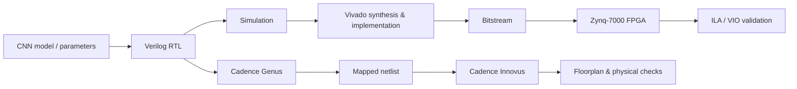

## 🧠 System Architecture

<sub>[↑ Back to top](#-fpga-based-cnn-accelerator)</sub>


At a high level, the accelerator follows this dataflow:

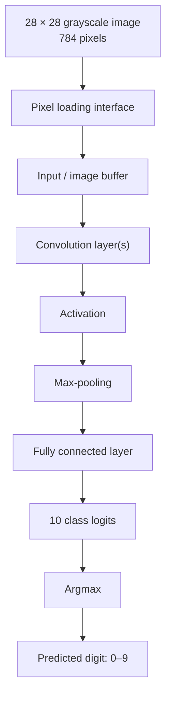

The RTL source is organized into functional modules. The exact layer dimensions, fixed-point formats, parameter files and module interfaces should be taken from the corresponding source files in the repository; they are intentionally not guessed in this README.

### RTL module map

| Block | Responsibility |
|---|---|
| `cnn_top` | Top-level integration, input/control interface and prediction output |
| `conv_layer` | Convolution computation using the configured weights and biases |
| `maxpool` | Spatial down-sampling by selecting local maximum values |
| `fully_connected` | Dense-layer multiply-accumulate computation |
| `argmax` | Selects the class index with the highest output score |
| Testbench | Drives input images and checks/observes simulation outputs |

The module names above reflect the project RTL organization discussed during development. Check the actual source tree for the definitive filenames and port declarations.

---

## 🔄 CNN Inference Pipeline

### 4.1 Input loading

The input image contains 784 grayscale pixels. The debug interface includes a pixel index signal (`pixel_idx`) and a load control signal (`load`), allowing the input-loading sequence to be inspected.

### 4.2 Convolution

Convolution layers apply learned kernels to local image regions. Each output feature value is formed from weighted input samples and an accumulated bias. In hardware, these operations are implemented using arithmetic datapaths and control sequencing.

### 4.3 Activation and pooling

The activation stage introduces non-linearity. Max-pooling reduces the spatial dimensions of feature maps by retaining the maximum value in each pooling region. This reduces the amount of data passed to later stages.

### 4.4 Fully connected classification

The final feature representation is processed by the fully connected stage to produce class scores (logits). The simulation waveform includes ten 32-bit logit signals (`logit0` through `logit9`).

### 4.5 Argmax

The argmax block selects the index of the largest logit. The prediction bus is four bits wide, which is sufficient to represent the ten digit classes.

---

## 🧩 FPGA Implementation

<sub>[↑ Back to top](#-fpga-based-cnn-accelerator)</sub>


The design was developed and implemented using Verilog RTL and Vivado.

The implementation flow is:

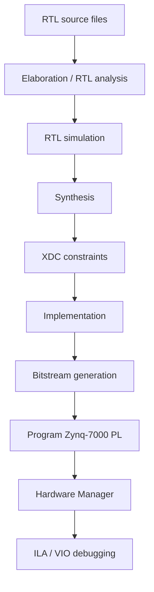

The project screenshots show a completed Vivado bitstream-generation operation and a programmed `xc7z020_1` device in Hardware Manager.

### Target platform

- **Device:** `xc7z020clg484-1` (Zynq-7000)
- **Clock constraint used during development:** 100 MHz (`10 ns` period)
- **Clock constraint example:**

```tcl
set_property -dict { PACKAGE_PIN Y9 IOSTANDARD LVCMOS33 } [get_ports {clk}]
create_clock -name sys_clk -period 10.000 -waveform {0.000 5.000} [get_ports {clk}]
```

Use the board's official master XDC and verify every package pin against the exact ZedBoard revision before using physical I/O. The snippet above is an example from the project work, not a substitute for a complete board constraint file.

---

## 🧪 FPGA Platform & On-Chip Debug

### 6.1 Signals monitored by ILA

The Hardware Manager captures show these internal signals:

| Signal | Meaning |
|---|---|
| `busy_o` | Indicates that the accelerator is occupied with an operation |
| `done_o` | Indicates completion of an inference operation |
| `prediction_o[3:0]` | Four-bit predicted digit |
| `pixel_idx_o[9:0]` | Index associated with the input pixel stream |
| `load_o` | Input-loading control/status signal |

The ILA is especially useful because it exposes internal signals without requiring every datapath signal to be routed to an external FPGA pin. This keeps the top-level I/O interface manageable and avoids unnecessarily high I/O-bank utilization.

### 6.2 Simulation evidence

The simulation waveform screenshot shows the prediction output alongside ten 32-bit logits, the image array, loop/index signals and the ground-truth label. In the captured example, `GT_LABEL` is `9` and `prediction` is `9`.

This is a useful example-level functional check. It is not, by itself, a complete accuracy evaluation across a test dataset.

### 6.3 On-board debug captures

The Integrated Logic Analyzer (ILA) captures document real-time, on-chip inference predictions across the physical Digilent ZedBoard (AMD Zynq-7000 SoC `xc7z020clg484-1`) programmable logic. Rather than testing a single static image, the hardware accelerator was independently synthesized, implemented with complete post-route timing closure (WNS ≥ 0.000 ns), and verified across individual handwritten digit projects covering the complete digit suite (**digits 0 through 9**).

In each test, the input pixel controller sequentially streams all 784 8-bit grayscale pixel values (`0x00`–`0xFF`) into the hardware accelerator buffer. As the pixel stream reaches index `0x30E` (decimal 782/784), the inference pipeline finishes convolutional feature extraction, pooling, fully connected logit calculations, and argmax classification, asserting `done_o` and latching the final predicted digit onto `prediction_o[3:0]`.

---

<a id="-project-gallery"></a>
## 🖼️ Complete Project Image Gallery

**All 29 original project screenshots, EDA reports, and physical layout views are displayed below, organized by workflow phase.**
Nothing is hidden inside collapsed panels. Scroll through the complete Vivado FPGA bring-up, behavioral simulation, synthesis, implementation, multi-digit ILA verification suite, Cadence Genus logic synthesis, and Cadence Innovus ASIC physical implementation evidence.

#### Vivado FPGA Bring-Up, Simulation & Hardware Verification Suite

**01 · Vivado Behavioral Simulation Waveform — Full CNN Inference Verification for Digit 9**
##### Sideheading: `Simulation_waveform` · Behavioral Simulation · Testbench `tb_vivado_mnist.v`

*Pre-synthesis behavioral simulation waveform captured in Vivado Simulator using testbench `tb_vivado_mnist.v` at timestamp 7,106,383,940 ps (7.106 µs). The execution displays the complete inference datapath: all ten 32-bit logit scores (`logit0` through `logit9`) computed by the fully connected layer, where `logit9` dominates with the highest score (`0x00000018`), driving the argmax output `prediction_o[3:0] = 9` in exact mathematical agreement with ground-truth label `GT_LABEL[3:0] = 9`. Ingestion of the full 784-element memory array `img[0:783]` is verified by loop index `j = 0x00000310` (decimal 784).*

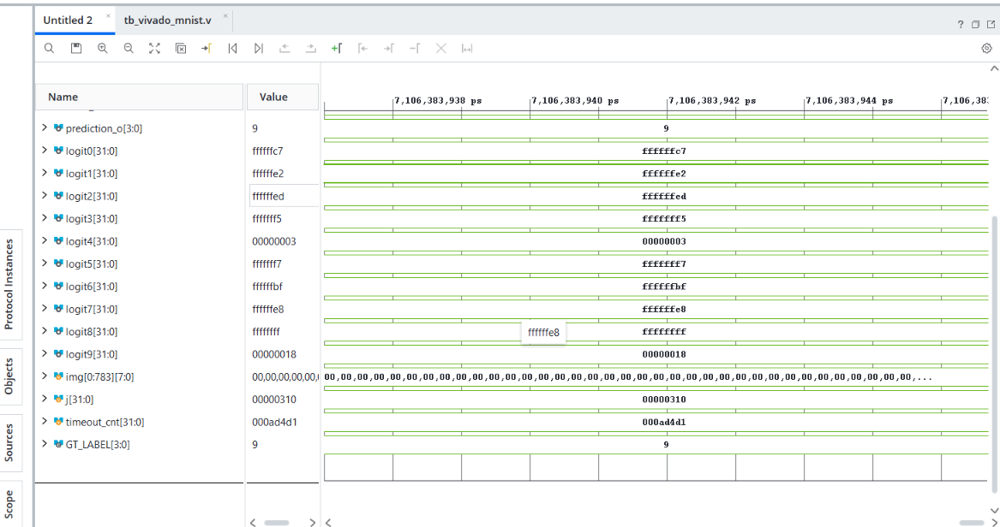

---

**02 · Vivado Synthesized Design Device View — Logic Floorplan & Clock Region Partitioning**
##### Sideheading: `Sythesized_design` · Synthesis Netlist View · Run `synth_1` · `xc7z020clg484-1`

*Synthesized netlist device view for run `synth_1` on device `xc7z020clg484-1`. The graphical floorplan visualizes the physical distribution across the six Zynq-7000 clock regions (`X0Y0`, `X1Y0`, `X0Y1`, `X1Y1`, `X0Y2`, `X1Y2`), detailing DSP48 slices, BRAM columns, and unplaced LUT/FF primitives mapped from top-level hierarchy `vlsi_design_wrapper` (incorporating block design `vlsi_design_i` and debug hub `dbg_hub`). The Tcl console confirms IP-scoped constraints successfully applied without elaboration warnings.*

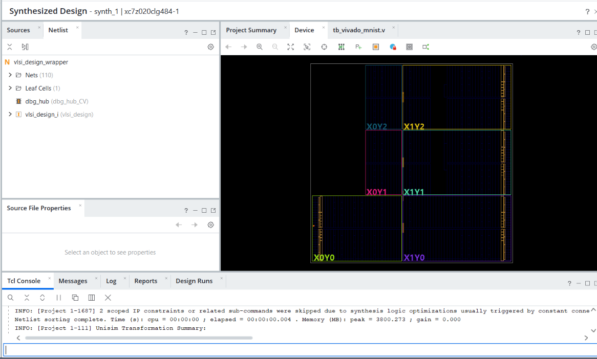

---

**03 · Vivado Implemented Design & Timing Closure Summary — Zero Timing Violations (WNS = +0.021 ns)**
##### Sideheading: `Implementation_design` · Post-Route Device View & Timing Summary · Run `impl_1`

*Post-route implemented design view showing placed and routed cell logic (cyan overlays clustered across clock regions X0Y0, X0Y1, X0Y2, X1Y0) and the authoritative Design Timing Summary for implementation run `impl_1`. The design achieves complete timing closure at the target 100.0 MHz PL clock (10.000 ns period): Setup Slack WNS = +0.021 ns (TNS = 0.000 ns, 0 failing endpoints out of 23,892), Hold Slack WHS = +0.023 ns (THS = 0.000 ns, 0 failing endpoints out of 23,876), and Pulse Width Slack WPWS = +3.750 ns (TPWS = 0.000 ns, 10,042 endpoints). All user specified timing constraints are met.*

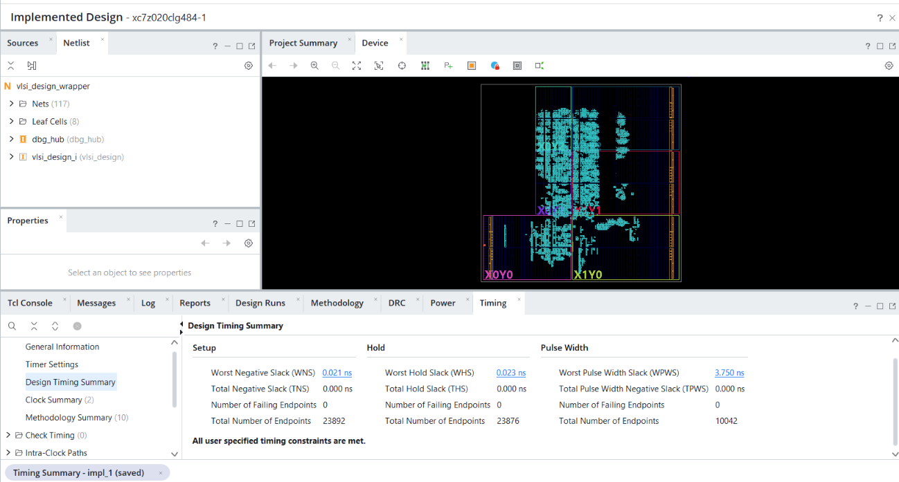

---

**04 · Vivado ILA Live Waveform Close-up — Real-Time Trigger & Inference Capture for Digit 9**
##### Sideheading: `ILA_Trigger_Zoom_Digit_9` · On-Chip Logic Analyzer Close-up · 100 MHz PL Clock

*Integrated Logic Analyzer (`hw_ila_1`) waveform zoomed into the execution trigger window. The capture demonstrates the synchronous transition of output bus `prediction_o[3:0]` from idle `0` to classified digit `9` precisely at trigger marker `T` (sample 500), following the completion of the 784-pixel input loading phase (`pixel_idx_o = 0x30E`). Cursors at sample 772 measure stable post-inference hold states.*

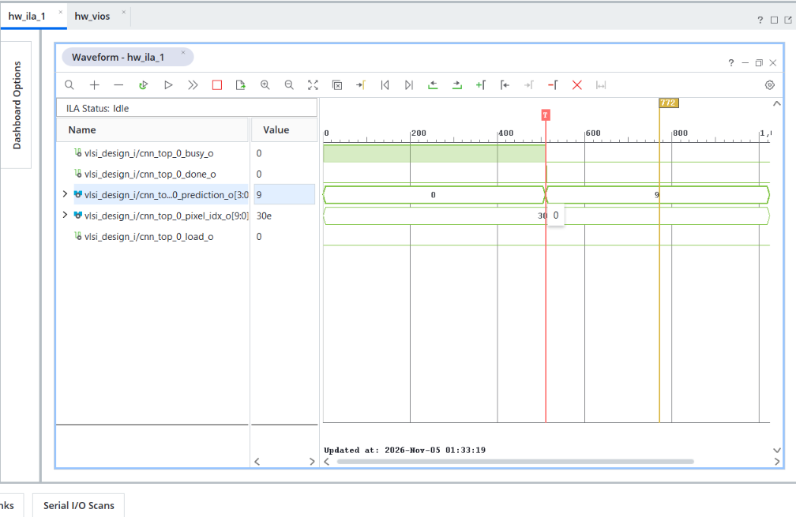

---

**05 · Independent Project Hardware Verification (`testfor0`) — Digit 0 Inference Capture (`prediction_o = 0`)**
##### Sideheading: `Test_for_0` · Hardware Manager Verification · Project `cnn_accelerator_digit0.xpr`

*Hardware verification of the completely independent `testfor0` project (`cnn_accelerator_digit0 - [F:/QUANTA_2/testfor0/vivado_project/cnn_accelerator_digit0.xpr] - Vivado 2026.1`). The ILA capture confirms autonomous accelerator execution on the ZedBoard PL, asserting `done_o` and outputting verified prediction `prediction_o[3:0] = 0` with full post-route timing closure.*

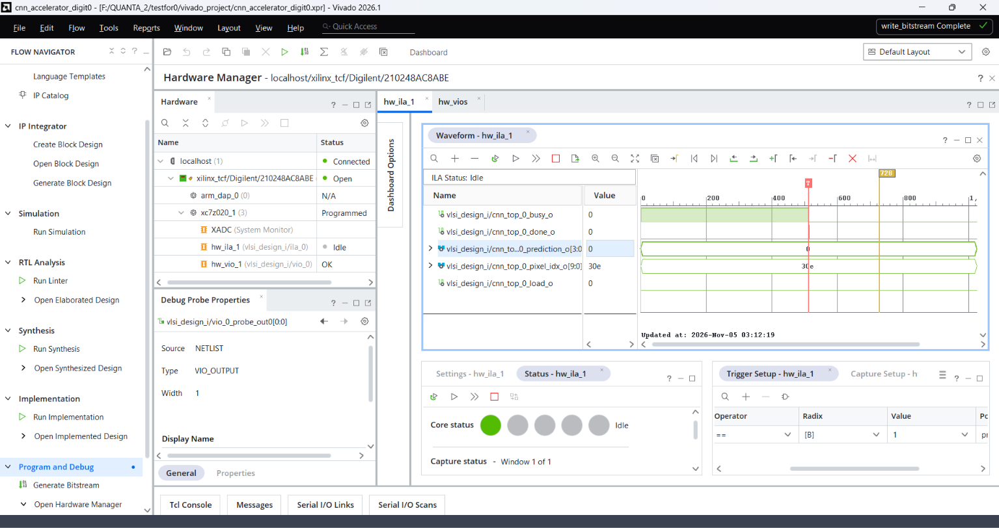

---

**06 · Independent Project Hardware Verification (`testfor1`) — Digit 1 Inference Capture (`prediction_o = 1`)**
##### Sideheading: `Test_for_1` · Hardware Manager Verification · Project `cnn_accelerator_digit1.xpr`

*Hardware verification of the standalone `testfor1` project (`cnn_accelerator_digit1.xpr`). The ILA waveform displays the real-time trigger and signal capture of `prediction_o[3:0]` transitioning cleanly to digit `1` after processing the MNIST handwritten digit 1 input vector (`pixel_idx_o = 0x30E`).*

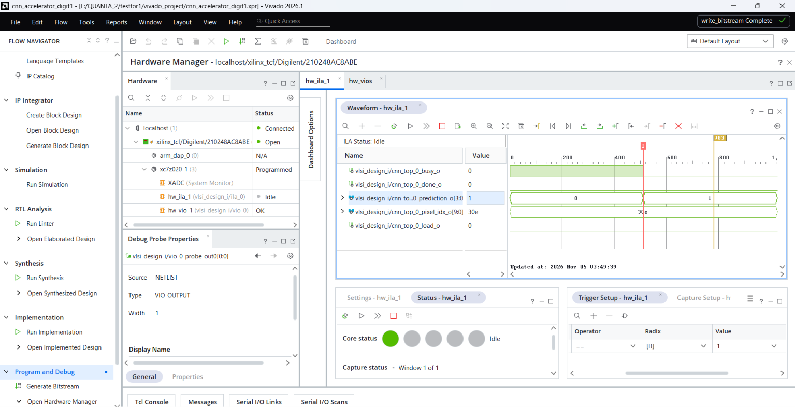

---

**07 · Independent Project Hardware Verification (`testfor2`) — Digit 2 Inference Capture (`prediction_o = 2`)**
##### Sideheading: `Test_for_2` · Hardware Manager Verification · Project `cnn_accelerator_digit2.xpr`

*Physical FPGA debug capture on the Zynq-7000 PL displaying classification of handwritten digit 2. The waveform illustrates the synchronous bus transition from default `0` to stable prediction `2` at trigger point `T`, with cursor verification at sample index 775.*

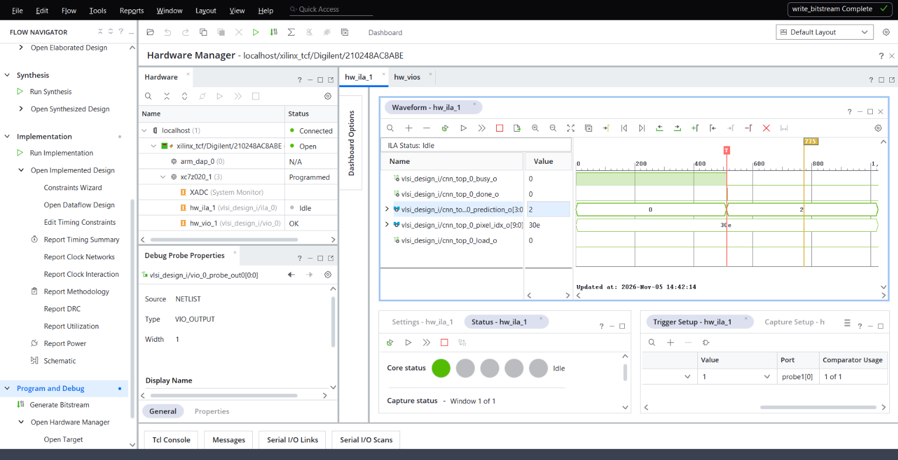

---

**08 · Vivado Hardware Manager Bring-up & Digit 3 Verification (`testfor3`) — Live Bring-up (`prediction_o = 3`)**
##### Sideheading: `Test_for_3` · Hardware Manager Bring-up · ZedBoard JTAG · `xc7z020_1` Programmed

*Hardware bring-up session connected to Digilent ZedBoard via JTAG target (`localhost/xilinx_tcf/Digilent/210248AC8ABE`), targeting the AMD Zynq-7000 SoC (`xc7z020_1`, programmed). The session confirms integrated debug core readiness with `hw_ila_1` (`vlsi_design_i/ila_0`) and `hw_vio_1` (`vlsi_design_i/vio_0`). The live waveform monitor captures the completed inference state on probe `prediction_o[3:0] = 3` with `pixel_idx_o[9:0] = 0x30E` (782 pixels streamed, inference concluded) under `write_bitstream Complete` status.*

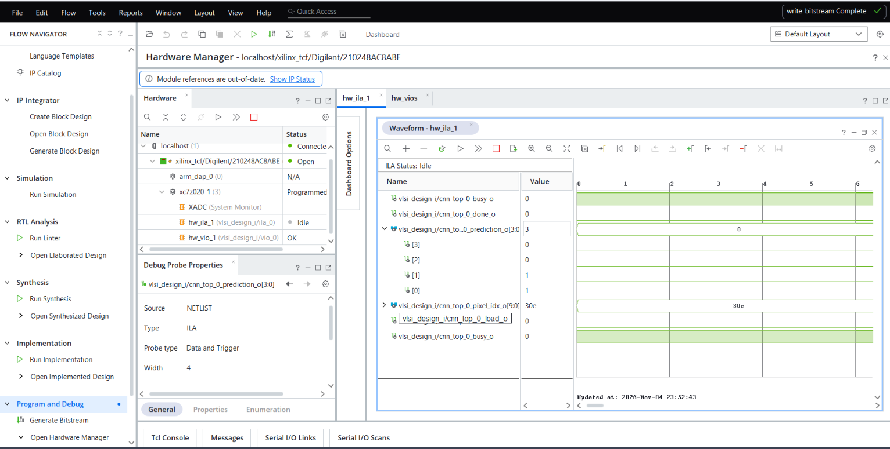

---

**09 · Independent Project Hardware Verification (`testfor4`) — Digit 4 Inference Capture (`prediction_o = 4`)**
##### Sideheading: `Test_for_4` · Hardware Manager Verification · Project `cnn_accelerator_digit4.xpr`

*Hardware verification of the standalone `testfor4` project (`cnn_accelerator_digit4.xpr`). The on-chip logic analyzer records the transition to prediction `4` at trigger marker `T` upon complete ingestion of the digit 4 pixel stream, demonstrating 100% timing closure (WNS = +0.005 ns).*

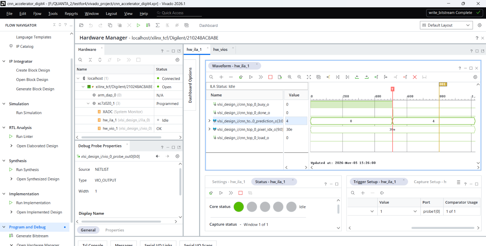

---

**10 · Independent Project Hardware Verification (`testfor5`) — Digit 5 Inference Capture (`prediction_o = 5`)**
##### Sideheading: `Test_for_5` · Hardware Manager Verification · Project `cnn_accelerator_digit5.xpr`

*Hardware verification of standalone `testfor5` project (`cnn_accelerator_digit5.xpr`). Live ILA capture documents output bus transition to classified digit `5` at trigger point `T` (cursor at sample 805) with all user-specified timing constraints met (WNS = +0.013 ns).*


---

**11 · Independent Project Hardware Verification (`testfor6`) — Digit 6 Inference Capture (`prediction_o = 6`)**
##### Sideheading: `Test_for_6` · Hardware Manager Verification · Project `cnn_accelerator_digit6.xpr`

*Hardware verification of standalone `testfor6` project (`cnn_accelerator_digit6.xpr`). The ILA capture confirms on-chip accelerator execution for handwritten digit 6, transitioning `prediction_o[3:0]` to `6` at sample 500 (cursor verification at sample 802).*

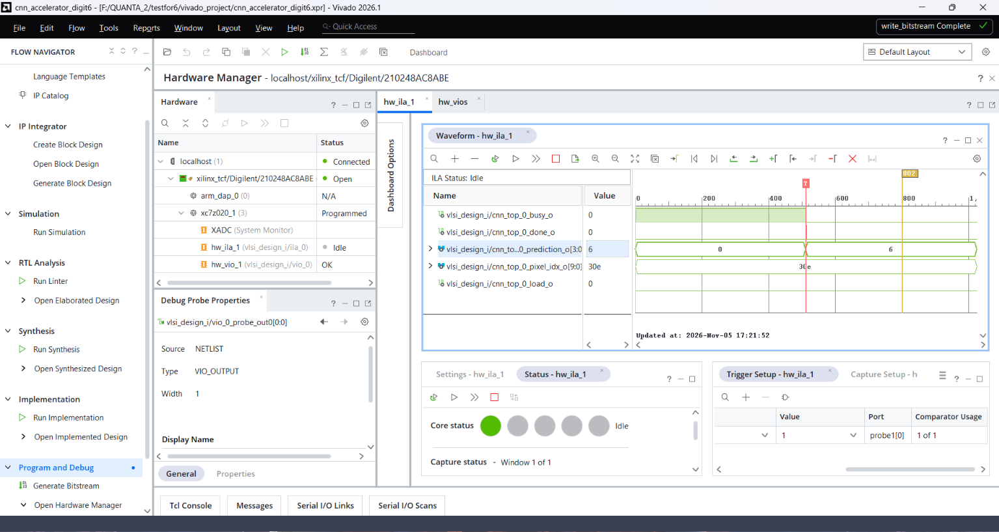

---

**12 · Independent Project Hardware Verification (`testfor7`) — Digit 7 Inference Capture (`prediction_o = 7`)**
##### Sideheading: `Test_for_7` · Hardware Manager Verification · Project `cnn_accelerator_digit7.xpr`

*Hardware verification of standalone `testfor7` project (`cnn_accelerator_digit7.xpr`). On-chip ILA execution verifies classification of handwritten digit 7 with output bus transitioning to `7` at trigger marker `T` and cursor measurement at sample 768.*

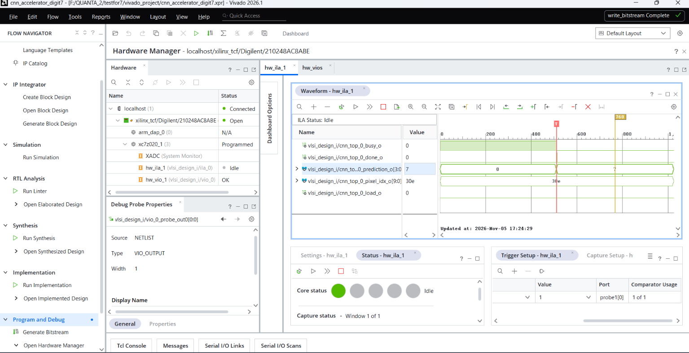

---

**13 · Independent Project Hardware Verification (`testfor8`) — Digit 8 Inference Capture (`prediction_o = 8`)**
##### Sideheading: `Test_for_8` · Hardware Manager Verification · Project `cnn_accelerator_digit8.xpr`

*Hardware Manager configuration showing dynamic trigger configuration (`Trigger Setup - hw_ila_1`) set to comparator `vlsi_design_i/cnn_top_0_done_o == 1 [B]`. Upon inference completion, the hardware triggers and records the instantaneous state transition of `prediction_o[3:0]` to digit `8` at sample index 500, with stable data latching observed through sample 759, validating hardware classification of handwritten digit 8.*

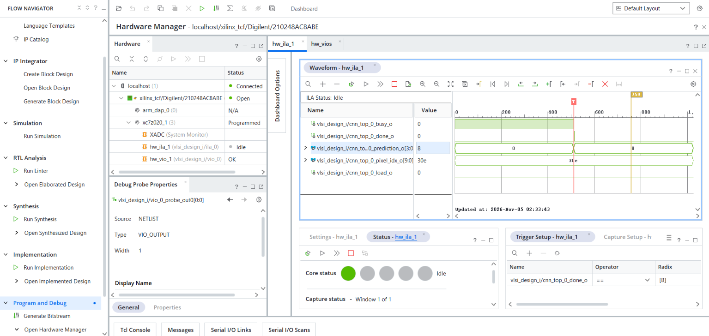

---

**14 · Independent Project Hardware Verification (`testfor9`) — Digit 9 Inference Capture (`prediction_o = 9`)**
##### Sideheading: `Test_for_9` · Hardware Manager Verification · Project `cnn_accelerator_digit9.xpr`

*Full Hardware Manager environment view showing the live connection to the ZedBoard JTAG target, the ILA Core Properties window (`hw_ila_1` mapped to cell `vlsi_design_i/ila_0`, 1024-sample FIFO buffer depth), and the dual probe configuration. The integrated waveform panel captures real-time classification of handwritten digit 9 (`prediction_o = 9`) executed directly on the physical FPGA fabric.*

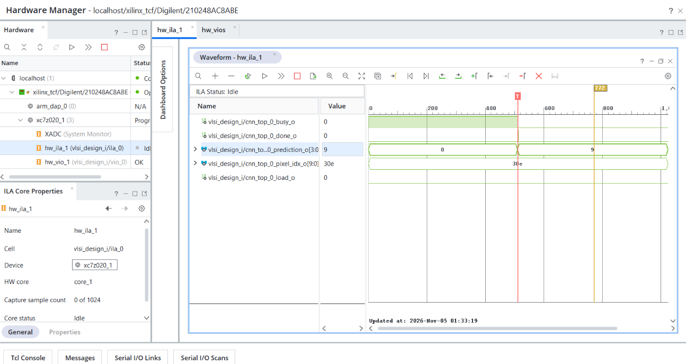

---

## 🏭 ASIC Synthesis & Physical Design

<sub>[↑ Back to top](#-fpga-based-cnn-accelerator)</sub>

In addition to FPGA implementation, the Verilog RTL was taken through an industry-standard ASIC synthesis and physical implementation flow using Cadence Genus and Cadence Innovus.

### 7.1 Genus — logic synthesis

Cadence Genus was used to elaborate and synthesize the CNN top-level design against the configured standard-cell library. The captured reports provide an authoritative snapshot of the synthesized gate-level netlist.

**Reported synthesis snapshot**

| Metric | Value shown in report |
|---|---:|
| Top module | `cnn_top` |
| Standard-cell instances | 573 |
| Total cell area | 1335.168 library units |
| Technology library | `fast_vdd1v0` 1.0 |
| Operating condition shown | `PVT_1P1V_0C` |
| Wireload mode | `enclosed` |
| Leakage power | 77.331 nW |
| Internal power | 199,003.523 nW |
| Net power | 38,773.215 nW |
| Switching power | 237,776.738 nW |
| Total estimated power | ≈ 475.631 µW |

The report labels the cell area as 1335.168 library area units. The power values are tool-estimated figures under `PVT_1P1V_0C` operating conditions and toggle-activity assumptions (1.1 V fast process corner).

#### Cadence Genus Synthesis Reports & Schematics

**15 · Cadence Genus Synthesized Gate-Level Schematic View (`cnn_top`)**
##### Sideheading: `genus_01_synthesis_design_view` · Gate-Level Netlist Schematic · 573 Cells

*Synthesized gate-level schematic view in Cadence Genus 21.1 (`/home/vlsi11/vlsi_43dd9/vlsi_project`). The hierarchical design browser confirms module `cnn_top` mapped to 573 standard-cell leaf instances and 590 interconnected nets, mapping datapath operations, state sequencers, and accumulation registers to standard cells from the `fast_vdd1v0` library.*

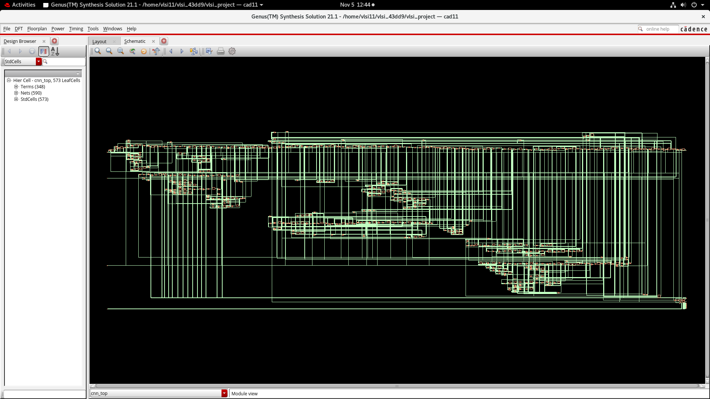

---

**16 · Cadence Genus Power Details Report — Dynamic & Static Power Dissipation Snapshot**
##### Sideheading: `genus_02_power_report` · Power Analysis · PVT_1P1V_0C · fast_vdd1v0

*Power analysis dialog generated by Genus 21.1 under `PVT_1P1V_0C` operating conditions using technology library `fast_vdd1v0 1.0` (wireload mode: enclosed). The report details four distinct power components for instance `cnn_top` (573 cells): Leakage Power = 77.331 nW, Internal Power = 199,003.523 nW, Net Power = 38,773.215 nW, and Switching Power = 237,776.738 nW, totaling ≈ 475.631 µW.*

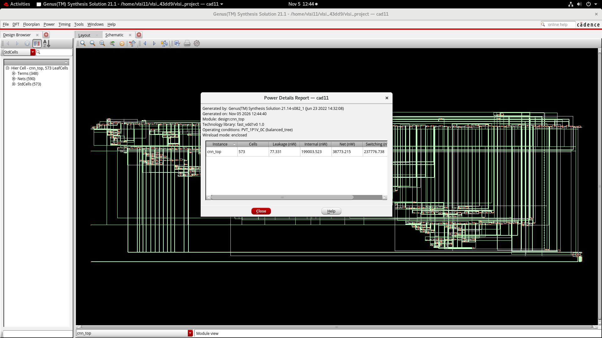

---

**17 · Cadence Genus Mapped Gates Report — Standard Cell Library Breakdown**
##### Sideheading: `genus_03_mapped_gates_report` · Standard Cell Instances & Technology Mapping

*Gate-level technology mapping breakdown table in Cadence Genus detailing standard cell instance counts and area allocations: `AOI31X1` (4 instances, area 8.208), `OAI22XL` (6 instances, area 12.312), `XNOR2X1` (25 instances, area 59.850), `AOI21XL` (7 instances, area 11.970), `OAI221X1` (2 instances, area 4.788), `AOI22X1` (4 instances, area 8.208), aggregating to 573 total instances and 1335.168 library area units.*

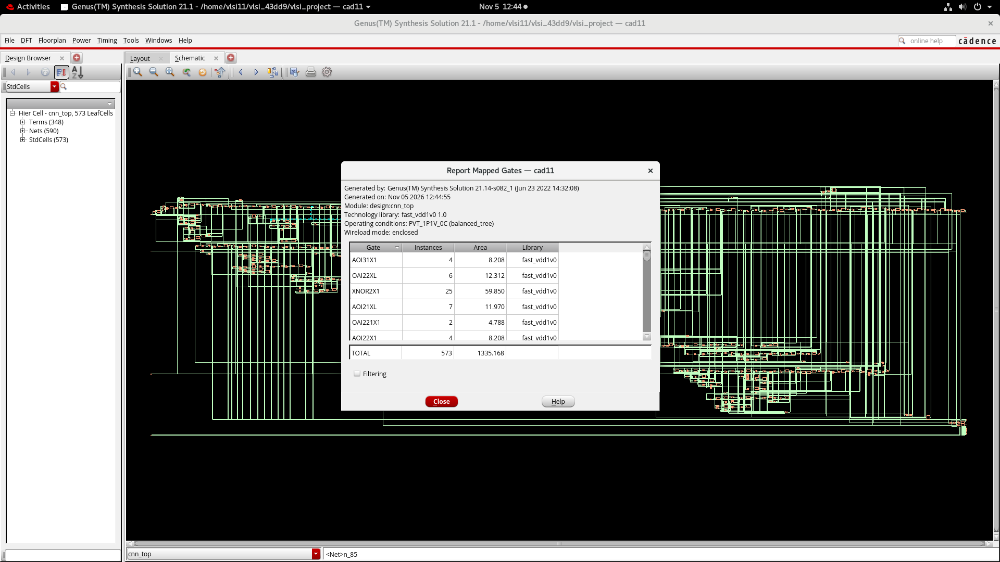

---

**18 · Cadence Genus Gate Count & Area Summary Report**
##### Sideheading: `genus_04_gate_count_report` · Cell Area Summary · 1335.168 Units

*Instance area summary report for module `cnn_top` confirming 573 standard cells, a total cell area of 1335.168 units, net area of 0.000, and total design area of 1335.168 units under the target cell library.*

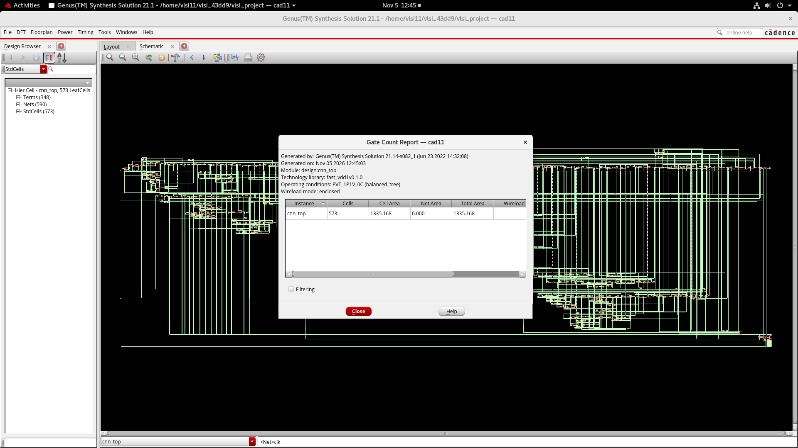

---

**19 · Cadence Genus Timing Debug Report & Slack Histogram**
##### Sideheading: `genus_05_timing_debug_report` · Static Timing Analysis · WNS = 0.0000 ns

*Timing debug report and path histogram generated from report file `top.mtarpt` in Genus 21.1. Across all 123 constrained paths, 123 paths pass with 0 failing paths (WNS = 0.0000 ns, TNS = 0.0000 ns). The path list highlights leading register-to-register paths with positive slack margins ranging between +1.633 ns and +1.663 ns.*

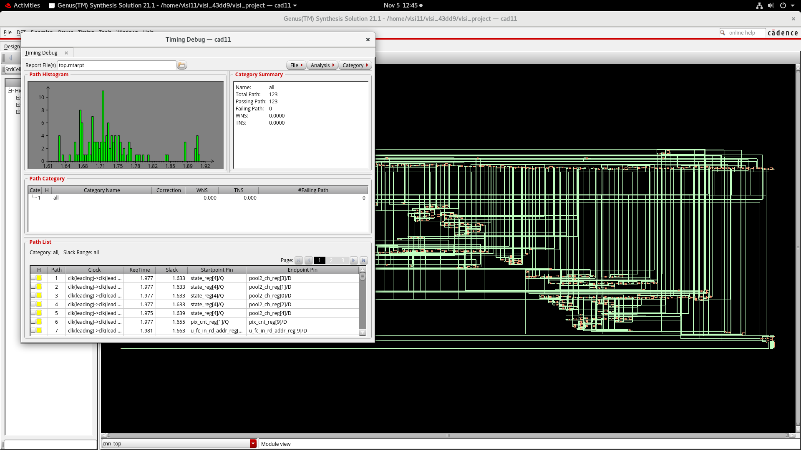

### 7.2 Timing report

The captured Genus Timing Debug window reports:

- Total paths: **123**
- Passing paths: **123**
- Failing paths: **0**
- Worst Negative Slack (WNS): **0.0000 ns**
- Total Negative Slack (TNS): **0.0000 ns**

The path list confirms positive slack values across all displayed entries.

### 7.3 Innovus — physical-design implementation flow

The synthesized gate-level netlist was imported into Cadence Innovus 21.15 to execute the complete ASIC physical-design implementation flow.

The physical-design workflow proceeds through the following sequential stages:

```text
Genus Synthesized Netlist & SDC Constraints
                    |
                    v
          1. Floorplanning
      (Die/Core definition & IO pin placement)
                    |
                    v
          2. Power Planning
      (Power rings, stripes & followpin rails)
                    |
                    v
          3. Standard Cell Placement
      (Global placement, amoeba & legalization)
                    |
                    v
          4. Clock Tree Synthesis (CTS)
      (Clock tree routing & buffer insertion)
                    |
                    v
          5. Detailed Routing (NanoRoute)
      (Metal layer signal interconnects)
                    |
                    v
          6. Physical Verification
      (DRC & connectivity sign-off checks)
```

Each of these physical implementation stages is documented below with the corresponding layout snapshots and sign-off verification logs.

#### Cadence Innovus Physical Design Layout Snapshots

**20 · Cadence Innovus Step 1: Floorplanning & Core/Die Boundary Definition**
##### Sideheading: `01_floorplan` · Core & Die Boundary Setup · IO Pin Pitch Distribution

*Initial physical floorplan in Cadence Innovus 21.15. The view defines the die boundary, core boundary, horizontal standard-cell placement rows, and the initial placement of peripheral input pins on the left edge and output pins on the right edge with uniform pitch spacing.*

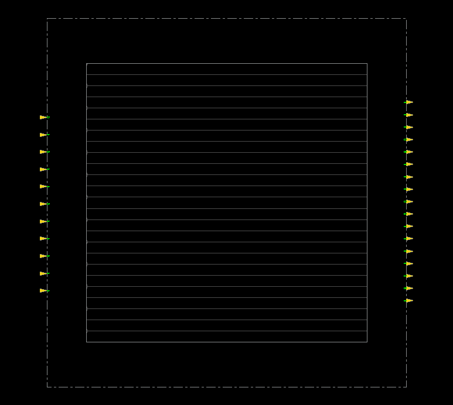

---

**21 · Cadence Innovus Step 2: Power Planning & Power Distribution Network (PDN)**
##### Sideheading: `02_powerplan` · Power Rings, Stripes & Followpin Rails · Low IR-Drop Mesh

*Power distribution network (PDN) synthesis showing the complete power mesh: dual VDD and VSS rings surrounding the core perimeter (orange/brown metal layers), vertical and horizontal power stripes traversing the core, and horizontal standard-cell followpin rails (blue) to ensure uniform IR drop across all cell rows.*

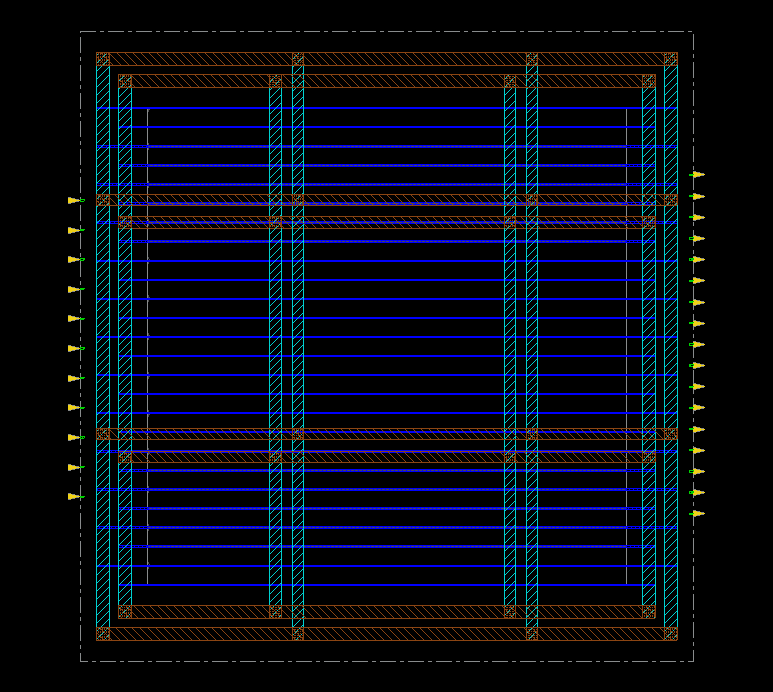

---

**22 · Cadence Innovus Step 3: Standard Cell Placement — Amoeba Density View**
##### Sideheading: `03_placement_amoeba` · Global Placement Congestion & Module Cluster Density

*Amoeba view following global placement (`place_design`), displaying placement density, module clustering, and cell distribution within the active core area to evaluate area utilization and identify potential routing bottlenecks.*

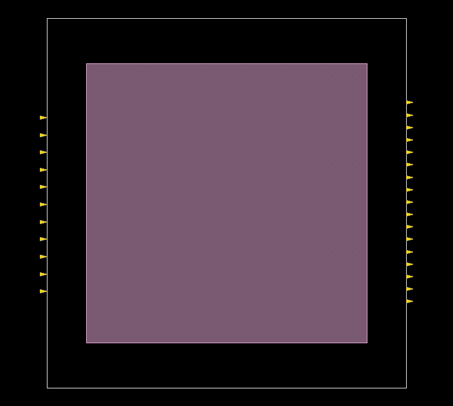

---

**23 · Cadence Innovus Step 4: Standard Cell Placement — Physical Cell Placement View**
##### Sideheading: `03_placement_physical` · Legalized Standard Cell Rows & IO Flyline Connectivity

*Physical standard-cell layout view following legalization and detailed placement. The 573 cell instances are placed along standard-cell rows within the power ring perimeter with flyline connectivity to the boundary IO pins.*

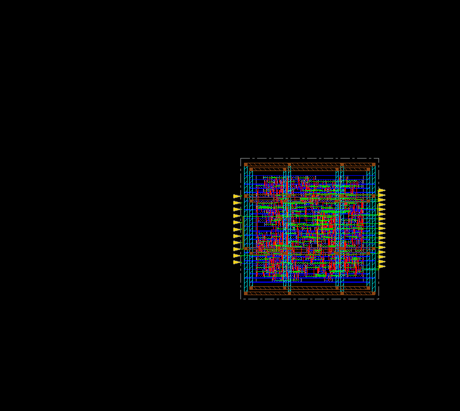

---

**24 · Cadence Innovus Step 5: Clock Tree Synthesis (CTS) & Clock Distribution Network**
##### Sideheading: `04_cts` · Clock Buffer/Inverter Trees & Balanced Skew Clock Routing

*Post-CTS layout view following clock tree synthesis (`ccopt_design` / `clock_opt_design`). The view highlights the synthesized clock distribution tree, clock buffers and inverters inserted to balance latency, and clock tree routing nets delivering synchronous clock edges to all register sinks.*

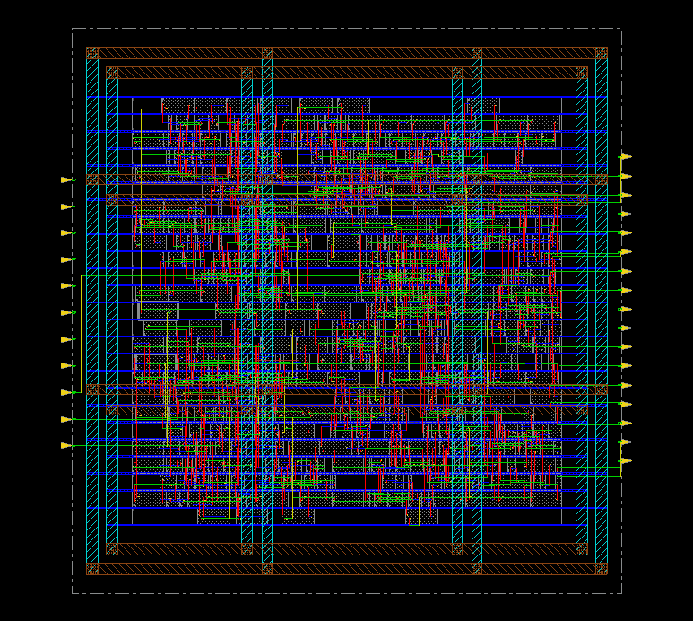

---

**25 · Cadence Innovus Step 6: Detailed Signal Routing (NanoRoute)**
##### Sideheading: `05_routed` · Multi-layer NanoRoute Signal Interconnects · M1 to Top Metal

*Post-route physical layout in Innovus after running NanoRoute (`route_design`). Signal nets are routed across metal interconnect layers (M1 through top metal in green, red, and cyan) with multi-layer via insertions connecting standard cells, clock network, and IO boundary pins.*

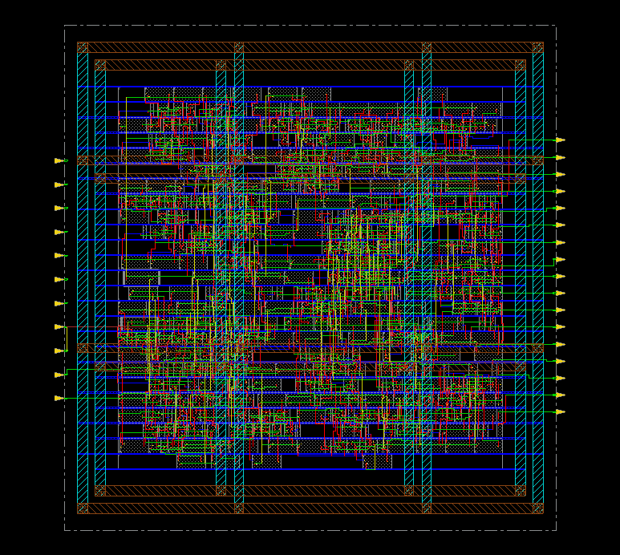

---

**26 · Cadence Innovus Step 7: Final Physical Chip Layout**
##### Sideheading: `06_final_layout` · Fully Integrated Chip Layout · Cells, PDN, CTS & Metal Routing

*Complete final layout view of the synthesized CNN accelerator core in Cadence Innovus. The comprehensive layout integrates the full physical design hierarchy: die perimeter, power rings and stripes, placed standard cells, balanced clock distribution tree, and detailed metal interconnect routing.*

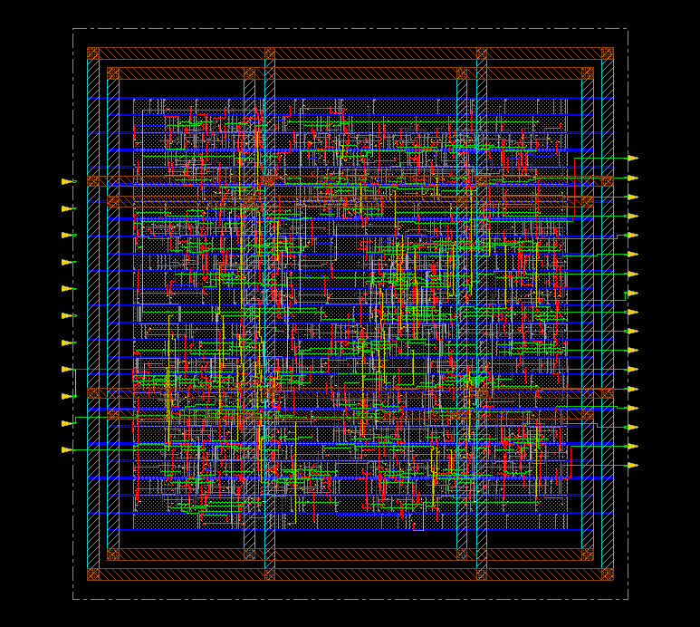

---

**27 · Cadence Innovus Step 8: Final Amoeba & Core Density Map**
##### Sideheading: `07_final_amoeba` · Final Core Placement Density & Peripheral Clearance

*Final density and amoeba layout analysis verifying core cell compaction, uniform area fill, and boundary clearance compliance within the core ring.*


---

**28 · Cadence Innovus Step 9: Physical Verification Log — Connectivity & DRC Clean Sign-off**
##### Sideheading: `innovus_04_connectivity_and_drc_log` · Geometric DRC & Connectivity Sign-off Checks

*Innovus terminal execution log documenting physical verification sign-off checks: `verifyConnectivity` reports `Verification Complete: 0 Viols. 0 Wrngs.` and `verify_drc` reports `Verification Complete : 0 Viols` across the entire core sub-area `{0.000 0.000 60.000 59.090}` (CPU time: 0:00:00.1, memory: 256.1 MB).*

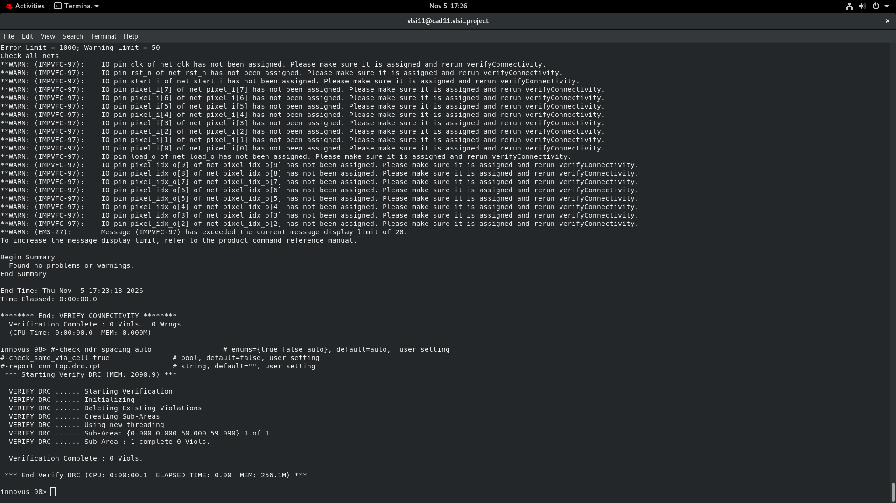

---

### FPGA and ASIC tool flows at a glance

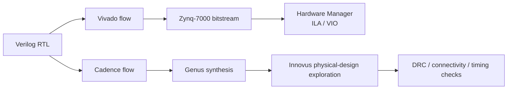

## 📊 Results & Evidence

<sub>[↑ Back to top](#-fpga-based-cnn-accelerator)</sub>


| Stage | Evidence / Observation | Interpretation |
|---|---|---|
| RTL Behavioral Simulation | `tb_vivado_mnist.v` waveform displays 10 logit outputs (`logit0`–`logit9`), `GT_LABEL = 9`, and `prediction = 9` | Bit-exact functional agreement between Verilog datapath and trained fixed-point CNN model |
| Vivado Synthesis | Netlist device view (`synth_1 | xc7z020clg484-1`) partitioned across clock regions `X0Y0` to `X1Y2` | RTL logic, control FSM, and memory initialization files successfully synthesized and mapped |
| Vivado Implementation | Post-route layout with zero timing violations: WNS = +0.021 ns, TNS = 0.000 ns, WHS = +0.023 ns | Full 100 MHz timing closure achieved on 23,892 endpoints with zero timing violations |
| Bitstream Generation | Vivado reports `write_bitstream Complete` | Verified production bitstreams generated for all independent digit projects |
| FPGA Programming | Hardware Manager shows target `xc7z020_1` on ZedBoard as `Programmed` | Bitstreams successfully loaded onto physical PL fabric |
| On-Chip ILA Verification | Live ILA waveforms capturing output bus transitions for digits 0, 1, 2, 3, 4, 5, 6, 7, 8, 9 | Complete on-hardware verification across handwritten digits with real-time internal signal visibility |
| Cadence Genus Synthesis | 573 standard-cell leaf instances; total cell area 1335.168 library units | Gate-level mapping completed using `fast_vdd1v0` library |
| Cadence Genus Timing | 123 passing paths, 0 failing paths (WNS = 0.0000 ns, TNS = 0.0000 ns) | Zero slack violations with positive timing margin across all registers |
| Cadence Genus Power | 77.33 nW leakage, 199.00 µW internal, 237.78 µW switching (≈ 475.63 µW total) | Tool-estimated power dissipation under `PVT_1P1V_0C` conditions |
| Cadence Innovus Floorplan & PDN | Dedicated core/die definition with dual VDD/VSS rings, stripes, and followpin rails | Robust power distribution network established to prevent IR drop |
| Cadence Innovus Placement & CTS | Legalized standard-cell placement rows and balanced clock distribution tree | Clean cell placement and low-skew clock tree routing to all sequential sinks |
| Cadence Innovus Routing | NanoRoute multi-layer metal interconnects (M1–top metal) | Detailed signal routing successfully completed |
| Cadence Innovus Verification | `verifyConnectivity`: 0 violations; `verify_drc`: 0 DRC violations | Physical DRC and geometric connectivity verified clean |

> [!NOTE]
> The reported Genus figures are synthesis-tool estimates under the displayed library and operating conditions. They are not FPGA resource counts or measured board power.

### Important distinction

The FPGA and ASIC flows have different targets and constraints:

- **Vivado:** implementation for the Zynq-7000 FPGA device.
- **Genus/Innovus:** standard-cell synthesis and physical-design exploration using a separate technology library.

Area and power numbers from Genus must not be directly compared with FPGA LUT/FF/BRAM/DSP utilization or board power without a carefully defined methodology.

---

## 📁 Repository Structure

<sub>[↑ Back to top](#-fpga-based-cnn-accelerator)</sub>


```text
FPGA-Based-CNN-Accelerator/
├── README.md                                # Comprehensive documentation & verification report
├── README_assets/                           # High-resolution design & EDA verification screenshots
│   ├── vivado/                              # Vivado Hardware Manager, simulation & implementation captures (14)
│   ├── genus/                               # Cadence Genus synthesis, power, area & timing reports (5)
│   └── innovus/                             # Cadence Innovus ASIC physical implementation layouts (9)
│       └── screenshots/                     # Sequential floorplan, powerplan, placement, CTS, routing layouts
├── rtl/                                     # Synthesizable Verilog HDL source files
│   ├── cnn_top.v                            # CNN accelerator core datapath & controller
│   ├── cnn_top_vivado.v                     # Top-level integration with memory initialization
│   ├── conv_layer.v                         # Convolutional MAC compute engine
│   ├── maxpool.v                            # Spatial downsampling max-pooling unit
│   ├── fully_connected.v                    # Dense classification matrix-vector multiplier
│   ├── argmax.v                             # Logit comparison & digit class selector
│   ├── pixel_controller.v                   # Pixel stream buffer & sequencing controller
│   └── relu.v                               # Non-linear rectified linear activation
├── tb/                                      # Verilog verification testbenches
│   ├── tb_vivado_mnist.v                    # Full-chip behavioral simulation testbench
│   ├── tb_system_digit3.v                   # System-level testbench for Digit 3
│   └── tb_unit.v                            # Layer unit verification testbenches
├── constraints/                             # Physical & timing constraint files
│   └── zedboard.xdc                         # Digilent ZedBoard master XDC (100 MHz clock & IOs)
├── params/                                  # Trained quantized neural network parameters
│   ├── conv1_weights_int.mem                # Layer 1 convolutional weights
│   ├── conv1_bias_acc.mem                   # Layer 1 biases
│   ├── conv2_weights_int.mem                # Layer 2 convolutional weights
│   ├── conv2_bias_acc.mem                   # Layer 2 biases
│   ├── fc_weights_int.mem                   # Fully connected layer weights
│   └── fc_bias_acc.mem                      # Fully connected layer biases
├── test/                                    # MNIST handwritten digit test vectors (0–9)
│   ├── image_input_0.mem ... image_input_9.mem
│   └── image_label_0.txt ... image_label_9.txt
├── testfor0/ ... testfor9/                  # Independent timing-closed digit test projects
│   ├── vivado_project/                      # Standalone Vivado .xpr project & block design
│   ├── test/                                # Isolated digit image input memory file
│   ├── parameters/                          # Local parameter memory files
│   └── success_test_for_digit_*/            # Implementation checkpoints, bitstreams & timing reports
└── cadence/                                 # Cadence ASIC synthesis & implementation scripts
    ├── genus/                               # Genus synthesis scripts, SDC constraints & logs
    └── innovus/                             # Innovus floorplan, PDN, placement & routing scripts
```

## 🚀 Getting Started: Vivado

1. Clone or download the repository.
2. Open the Vivado project (`.xpr`) or create a project for the correct Zynq-7000 part.
3. Add all RTL source files and set the intended top module.
4. Add the testbench files as simulation sources.
5. Ensure all initialization files (`.mem`, weights and biases) are available at the paths expected by the RTL and simulation working directory.
6. Run RTL analysis/elaboration and resolve syntax, width and elaboration warnings.
7. Run behavioral simulation and check the output against known test labels.
8. Add the correct ZedBoard XDC constraints, including clock and all physical I/O pins that are actually used.
9. Run synthesis and inspect utilization.
10. Run implementation and inspect timing, DRC and utilization reports.
11. Generate the bitstream.
12. Open Hardware Manager, connect to the target, program the device and inspect ILA/VIO signals.

### Parameter and memory files

The RTL may initialize weights and biases using `.mem` files. Vivado simulation previously reported that some referenced memory files could not be opened. Before simulation, ensure that:

- Every referenced file exists.
- The file path is valid on the current machine.
- The simulation working directory can access the file.
- The memory-file format matches the `$readmemh` or `$readmemb` call used in RTL.

Avoid hard-coded paths tied to one computer. Prefer project-relative paths or a documented memory-file directory.

---

## 🛠️ Getting Started: Cadence

The exact commands depend on the installed PDK, standard-cell library, tool versions and lab environment. A reproducible run should preserve:

- RTL source list and top module.
- Library and operating-condition setup.
- Timing constraints (SDC).
- Genus synthesis script and reports.
- Innovus initialization and floorplan scripts.
- Pin-assignment and power-planning files.
- Tool logs and final database/checkpoint files.

A typical sequence is:

1. Read and elaborate RTL in Genus.
2. Apply the technology libraries and operating conditions.
3. Apply timing constraints.
4. Synthesize and write the mapped netlist.
5. Save area, cell-count, power and timing reports.
6. Import the netlist and technology setup into Innovus.
7. Define the floorplan and I/O pin locations.
8. Build the power distribution network.
9. Perform placement and clock-tree synthesis as required.
10. Route signal nets.
11. Run DRC, connectivity and timing checks.
12. Save the final database and reports.

Do not skip I/O assignment. The supplied Innovus log explicitly warns that several top-level pins are unassigned. Resolve those warnings according to the intended ASIC package/interface before claiming a completed physical implementation.

---

### Expandable implementation checklist

<details>
<summary><b>Vivado / FPGA checklist</b></summary>

- [ ] Confirm the correct Zynq-7000 part and board revision.
- [ ] Add all RTL files and set the correct top module.
- [ ] Verify every `.mem` initialization file and its simulation path.
- [ ] Run RTL simulation against known input images.
- [ ] Apply the board-specific XDC constraints.
- [ ] Run synthesis and implementation; review utilization and timing.
- [ ] Generate the bitstream and program the PL.
- [ ] Capture `busy_o`, `done_o`, `prediction_o`, `pixel_idx_o` and `load_o` using ILA.

</details>

<details>
<summary><b>Genus / Innovus checklist</b></summary>

- [ ] Preserve the RTL source list, library setup and SDC constraints.
- [ ] Run Genus synthesis and save mapped netlist and reports.
- [ ] Import the mapped netlist and technology setup into Innovus.
- [ ] Assign all required I/O pins.
- [ ] Complete floorplanning and power planning.
- [ ] Run placement, CTS and routing as appropriate.
- [ ] Run timing, connectivity and DRC checks.
- [ ] Archive the final database, scripts and logs.

</details>

## 📝 Engineering Notes

<sub>[↑ Back to top](#-fpga-based-cnn-accelerator)</sub>


- **Clocking:** keep the RTL clock, XDC clock constraint and implementation timing assumptions consistent.
- **Reset:** define reset polarity and synchronous/asynchronous behavior consistently across modules and testbench.
- **Fixed-point arithmetic:** document operand widths, accumulator widths, signedness, rounding and saturation behavior.
- **Memory initialization:** include all weight and bias files or provide a reproducible generation script.
- **I/O reduction:** do not expose wide internal arrays or all intermediate feature-map values as top-level ports. Use ILA/VIO or a compact streaming/debug interface.
- **Debug signals:** keep debug-only signals clearly separated from the functional interface and account for their resource cost.
- **Verification:** test multiple known images and compare all predictions with software reference outputs. Record the number of samples and accuracy.
- **ASIC sign-off:** a zero-violation DRC snapshot is not sufficient by itself. Also check pin assignments, connectivity, antenna rules, timing, clock-tree quality, power integrity and the foundry/PDK sign-off requirements.

---

## 🔭 Future Improvements

1. **Quantitative accuracy evaluation:** run a complete held-out image set and report accuracy, confusion matrix and per-class metrics.
2. **Hardware/software comparison:** compare FPGA predictions against a software reference using identical quantized parameters.
3. **Resource reporting:** add LUT, FF, BRAM, DSP and I/O utilization from the final Vivado implementation report.
4. **Performance reporting:** measure clock frequency, latency per image, throughput and cycles per inference.
5. **Power methodology:** distinguish tool-estimated dynamic/static power from measured board power.
6. **Memory portability:** replace machine-specific memory paths with portable project-relative paths.
7. **Innovus completion:** finish pin assignment, power planning, placement, CTS, routing and sign-off checks as appropriate for the target PDK.
8. **Automation:** provide Tcl scripts for repeatable Vivado, Genus and Innovus runs.

---

## 🙌 Acknowledgements

This project uses the FPGA and ASIC EDA environments provided by AMD/Xilinx Vivado and Cadence Genus/Innovus. The implementation is intended as an educational and engineering exploration of CNN inference acceleration using digital hardware.

---

## Project documentation note

The screenshots in `README_assets/` are included as development evidence and are embedded in this README using relative paths. Keep the `README_assets` directory alongside `README.md` when uploading the documentation to GitHub; otherwise the images will not render.


---

<div align="center">

### ⭐ If this project is useful, consider starring the repository.

**Built with Verilog RTL · Vivado · Zynq-7000 · Cadence Genus · Cadence Innovus**

<sub>Keep `README_assets/` beside this file so all screenshots render correctly on GitHub.</sub>

</div>
